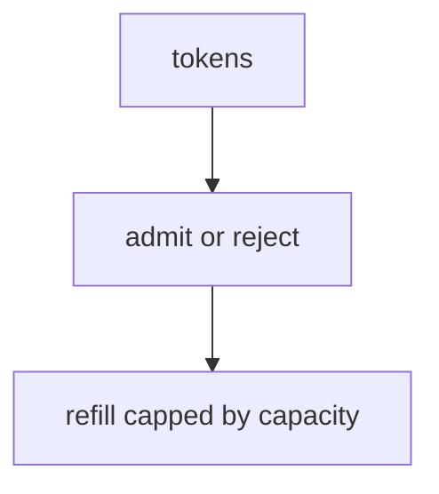

# A03.32 · rate limits and quotas

[Phase index](../README.md) · [Principal] · 25–40 minutes

Prerequisite [A03.31](A03.31.md) · Next [A03.33](A03.33.md)

## 1. The problem & why it exists

Bursty clients consume all service capacity before a monthly quota is exhausted. Use per-tenant limits and choose explicitly whether counters include rejected attempts.

## 2. Visual mental model



```text
1. tokens
2. admit or reject
3. refill capped by capacity
```

The diagram isolates the mechanism on one request or process. Deployment limits and concurrent work can introduce additional boundaries.

## 3. Step-by-step mechanism & minimal dry-run

A rate limiter bounds requests per time or burst, while a quota constrains total usage over a longer window. A token bucket refills at a fixed rate up to capacity.

**Trace.** tokens → admit or reject → refill capped by capacity.

Run the example twice. Identify the first state where the controlled failure changes the behavior or assumption.

## 4. Formal rigor & quantitative math

With capacity 5 and refill 2 tokens/s, a drained bucket has 4 tokens after two seconds. Longer elapsed time cannot refill past 5.

Verify the worked calculation with Python.

```python
import math

actual = min(5, 2 * 2)
assert math.isclose(actual, 4, rel_tol=1e-4)
print(actual)
```

## 5. Progressive design

| Control | Observable evidence | Trade-off |
| --- | --- | --- |
| Failure | `tokens: 8` | Find the boundary where the fixture's incorrect assumption becomes visible. |
| Normal | `tokens: 5` | Use per-tenant limits and choose explicitly whether counters include rejected attempts. |

The [fixture](../examples/A03.32.py) is bounded. Check whether it runs the real runtime primitive or models a decision with fixed inputs before interpreting its output as production evidence.

## 6. Safe local lab & controlled failure injection

From the repository root, after `uv sync --locked --extra api`:

```sh
uv run --extra api python "01-architecture-A01-to-A20/A03-python-runtime-and-backend-apis/examples/A03.32.py"
uv run --extra api python "01-architecture-A01-to-A20/A03-python-runtime-and-backend-apis/examples/A03.32.py" --break
```

Predict both runs, measure the first difference, and rerun the normal control. Change one parameter in the worked example or one input to the fixture, recompute your expected result, and record any mismatch. Remove your scratch copy once you have the evidence. Continue to [L4](../labs/L4.md) for integration practice.

## 7. Production & multi-cloud bridge

Use per-tenant limits and choose explicitly whether counters include rejected attempts. For a container deployment on Amazon EKS, Azure AKS or Google Kubernetes Engine, locate the boundary in application code, process configuration and any service in the request path. Collect evidence at the affected boundary before changing infrastructure.

<details>
<summary>Principal discussion</summary>

Does a high monthly quota imply unlimited instantaneous burst? No. In a design review, state the observable signal that would confirm the diagnosis and name the owner of the boundary.

</details>

## 8. Memory hook & mastery checkpoint

1. Does a high monthly quota imply unlimited instantaneous burst?
2. State the observation for each control and locate their first divergence.
3. Change the worked input and calculate the result before running the check.
4. Explain which decision in section 5 you would preserve in a larger deployment.
5. Explain one difference between this fixture and production behavior.

<details>
<summary>Check your answers</summary>

1. No.
2. Normal `tokens: 5`. Failure `tokens: 8`.
3. Apply the relationship in section 4 to the modified input. Verify the output with the same units.
4. Use per-tenant limits and choose explicitly whether counters include rejected attempts.
5. A rate limiter bounds requests per time or burst, while a quota constrains total usage over a longer window. A token bucket refills at a fixed rate up to capacity.

</details>

## Standards and implementation notes

- [Primary specification or implementation documentation](https://www.rfc-editor.org/rfc/rfc9110.html)
