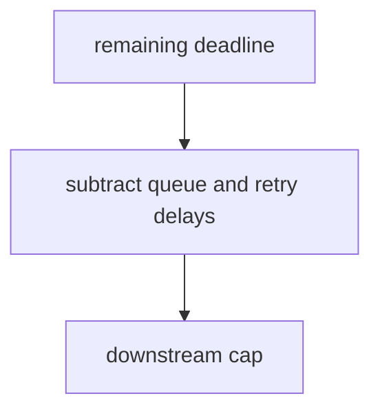

# A03.33 · retry/timeout propagation

[Phase index](../README.md) · [Principal] · 25–40 minutes

Prerequisite [A03.32](A03.32.md) · Next [A03.34](A03.34.md)

## 1. The problem & why it exists

A backend works for seconds after its caller has already timed out. Centralize retry ownership and handle unknown side effects safely.

## 2. Visual mental model



```text
1. remaining deadline
2. subtract queue and retry delays
3. downstream cap
```

The diagram isolates the mechanism on one request or process. Deployment limits and concurrent work can introduce additional boundaries.

## 3. Step-by-step mechanism & minimal dry-run

Propagate remaining deadlines and retry budgets across hops. Use a monotonic clock locally and define transport encoding for relative deadlines. Cancellation is cooperative across services.

**Trace.** remaining deadline → subtract queue and retry delays → downstream cap.

Run the example twice. Identify the first state where the controlled failure changes the behavior or assumption.

## 4. Formal rigor & quantitative math

If 350 ms remain, a 90 ms queue and 60 ms backoff leave 200 ms. A 220 ms minimum viable call should not start.

Verify the worked calculation with Python.

```python
import math

actual = 350 - 90 - 60
assert math.isclose(actual, 200, rel_tol=1e-4)
print(actual)
```

## 5. Progressive design

| Control | Observable evidence | Trade-off |
| --- | --- | --- |
| Failure | `admitted: True` | Find the boundary where the fixture's incorrect assumption becomes visible. |
| Normal | `admitted: False` | Centralize retry ownership and handle unknown side effects safely. |

The [fixture](../examples/A03.33.py) is bounded. Check whether it runs the real runtime primitive or models a decision with fixed inputs before interpreting its output as production evidence.

## 6. Safe local lab & controlled failure injection

From the repository root, after `uv sync --locked --extra api`:

```sh
uv run --extra api python "01-architecture-A01-to-A20/A03-python-runtime-and-backend-apis/examples/A03.33.py"
uv run --extra api python "01-architecture-A01-to-A20/A03-python-runtime-and-backend-apis/examples/A03.33.py" --break
```

Predict both runs, measure the first difference, and rerun the normal control. Change one parameter in the worked example or one input to the fixture, recompute your expected result, and record any mismatch. Remove your scratch copy once you have the evidence. Continue to [L4](../labs/L4.md) for integration practice.

## 7. Production & multi-cloud bridge

Centralize retry ownership and handle unknown side effects safely. For a container deployment on Amazon EKS, Azure AKS or Google Kubernetes Engine, locate the boundary in application code, process configuration and any service in the request path. Collect evidence at the affected boundary before changing infrastructure.

<details>
<summary>Principal discussion</summary>

Which clock is suitable for elapsed local timing? A monotonic clock. In a design review, state the observable signal that would confirm the diagnosis and name the owner of the boundary.

</details>

## 8. Memory hook & mastery checkpoint

1. Which clock is suitable for elapsed local timing?
2. State the observation for each control and locate their first divergence.
3. Change the worked input and calculate the result before running the check.
4. Explain which decision in section 5 you would preserve in a larger deployment.
5. Explain one difference between this fixture and production behavior.

<details>
<summary>Check your answers</summary>

1. A monotonic clock.
2. Normal `admitted: False`. Failure `admitted: True`.
3. Apply the relationship in section 4 to the modified input. Verify the output with the same units.
4. Centralize retry ownership and handle unknown side effects safely.
5. Propagate remaining deadlines and retry budgets across hops. Use a monotonic clock locally and define transport encoding for relative deadlines. Cancellation is cooperative across services.

</details>

## Standards and implementation notes

- [Primary specification or implementation documentation](https://www.python-httpx.org/advanced/timeouts/)
