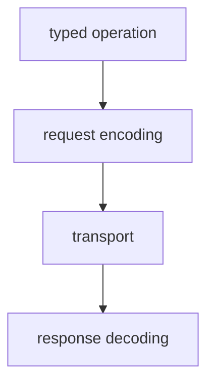

# A03.34 · SDK construction

[Phase index](../README.md) · [Principal] · 25–40 minutes

Prerequisite [A03.33](A03.33.md) · Next [A03.35](A03.35.md)

## 1. The problem & why it exists

Every SDK consumer repeats authentication, parsing and timeout handling. Isolate transport policy and expose stable exception categories rather than exposing raw responses everywhere.

## 2. Visual mental model



```text
1. typed operation
2. request encoding
3. transport
4. response decoding
```

The diagram isolates the mechanism on one request or process. Deployment limits and concurrent work can introduce additional boundaries.

## 3. Step-by-step mechanism & minimal dry-run

A transport adapter owns timeouts, decoding and retries, while a thin public API names operations and maps errors. Inject the transport for deterministic tests.

**Trace.** typed operation → request encoding → transport → response decoding.

Run the example twice. Identify the first state where the controlled failure changes the behavior or assumption.

## 4. Formal rigor & quantitative math

A common adapter for six methods replaces six timeout policies with one default and explicit per-operation overrides.

Verify the worked calculation with Python.

```python
import math

actual = len({operation: "shared policy" for operation in range(6)})
assert math.isclose(actual, 6, rel_tol=1e-4)
print(actual)
```

## 5. Progressive design

| Control | Observable evidence | Trade-off |
| --- | --- | --- |
| Failure | `{"name"` | Find the boundary where the fixture's incorrect assumption becomes visible. |
| Normal | `fixture` | Isolate transport policy and expose stable exception categories rather than exposing raw responses everywhere. |

The [fixture](../examples/A03.34.py) is bounded. Check whether it runs the real runtime primitive or models a decision with fixed inputs before interpreting its output as production evidence.

## 6. Safe local lab & controlled failure injection

From the repository root, after `uv sync --locked --extra api`:

```sh
uv run --extra api python "01-architecture-A01-to-A20/A03-python-runtime-and-backend-apis/examples/A03.34.py"
uv run --extra api python "01-architecture-A01-to-A20/A03-python-runtime-and-backend-apis/examples/A03.34.py" --break
```

Predict both runs, measure the first difference, and rerun the normal control. Change one parameter in the worked example or one input to the fixture, recompute your expected result, and record any mismatch. Remove your scratch copy once you have the evidence. Continue to [L4](../labs/L4.md) for integration practice.

## 7. Production & multi-cloud bridge

Isolate transport policy and expose stable exception categories rather than exposing raw responses everywhere. For a container deployment on Amazon EKS, Azure AKS or Google Kubernetes Engine, locate the boundary in application code, process configuration and any service in the request path. Collect evidence at the affected boundary before changing infrastructure.

<details>
<summary>Principal discussion</summary>

What boundary should unit tests substitute? The transport or a local test server. In a design review, state the observable signal that would confirm the diagnosis and name the owner of the boundary.

</details>

## 8. Memory hook & mastery checkpoint

1. What boundary should unit tests substitute?
2. State the observation for each control and locate their first divergence.
3. Change the worked input and calculate the result before running the check.
4. Explain which decision in section 5 you would preserve in a larger deployment.
5. Explain one difference between this fixture and production behavior.

<details>
<summary>Check your answers</summary>

1. The transport or a local test server.
2. Normal `fixture`. Failure `{"name"`.
3. Apply the relationship in section 4 to the modified input. Verify the output with the same units.
4. Isolate transport policy and expose stable exception categories rather than exposing raw responses everywhere.
5. A transport adapter owns timeouts, decoding and retries, while a thin public API names operations and maps errors. Inject the transport for deterministic tests.

</details>

## Standards and implementation notes

- [Primary specification or implementation documentation](https://www.python-httpx.org/advanced/clients/)
