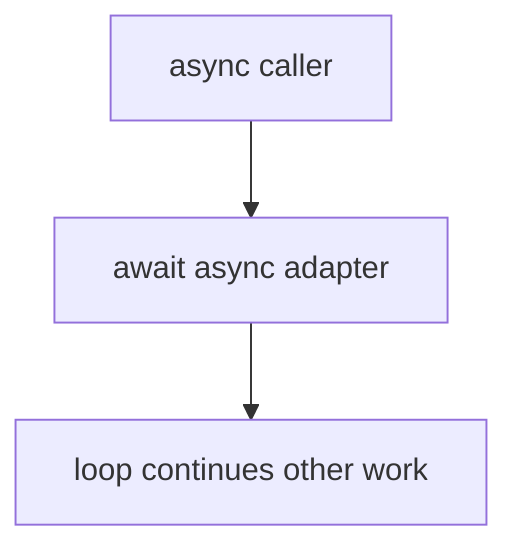

# A03.35 · sync vs async SDK boundary

[Phase index](../README.md) · [Principal] · 25–40 minutes

Prerequisite [A03.34](A03.34.md) · Next [A03.36](A03.36.md)

## 1. The problem & why it exists

A supposedly async SDK calls a synchronous HTTP method during every request. If no async API exists, use bounded thread offload and explicit cancellation semantics.

## 2. Visual mental model



```text
1. async caller
2. await async adapter
3. loop continues other work
```

The diagram isolates the mechanism on one request or process. Deployment limits and concurrent work can introduce additional boundaries.

## 3. Step-by-step mechanism & minimal dry-run

A synchronous client blocks its calling thread. An AsyncClient returns awaitable I/O. Expose a deliberate API boundary, reuse the appropriate transport type, and avoid starting nested loops.

**Trace.** async caller → await async adapter → loop continues other work.

Run the example twice. Identify the first state where the controlled failure changes the behavior or assumption.

## 4. Formal rigor & quantitative math

Two network waits of 80 ms can overlap toward 80 ms total. A blocking adapter invoked twice on the loop can occupy about 160 ms.

Verify the worked calculation with Python.

```python
import math

actual = 2 * 80
assert math.isclose(actual, 160, rel_tol=1e-4)
print(actual)
```

## 5. Progressive design

| Control | Observable evidence | Trade-off |
| --- | --- | --- |
| Failure | `adapter: False` | Find the boundary where the fixture's incorrect assumption becomes visible. |
| Normal | `adapter: True` | If no async API exists, use bounded thread offload and explicit cancellation semantics. |

The [fixture](../examples/A03.35.py) is bounded. Check whether it runs the real runtime primitive or models a decision with fixed inputs before interpreting its output as production evidence.

## 6. Safe local lab & controlled failure injection

From the repository root, after `uv sync --locked --extra api`:

```sh
uv run --extra api python "01-architecture-A01-to-A20/A03-python-runtime-and-backend-apis/examples/A03.35.py"
uv run --extra api python "01-architecture-A01-to-A20/A03-python-runtime-and-backend-apis/examples/A03.35.py" --break
```

Predict both runs, measure the first difference, and rerun the normal control. Change one parameter in the worked example or one input to the fixture, recompute your expected result, and record any mismatch. Remove your scratch copy once you have the evidence. Continue to [L2](../labs/L2.md) for integration practice.

## 7. Production & multi-cloud bridge

If no async API exists, use bounded thread offload and explicit cancellation semantics. For a container deployment on Amazon EKS, Azure AKS or Google Kubernetes Engine, locate the boundary in application code, process configuration and any service in the request path. Collect evidence at the affected boundary before changing infrastructure.

<details>
<summary>Principal discussion</summary>

Does cancelling to_thread stop an already-running synchronous operation? Generally no. In a design review, state the observable signal that would confirm the diagnosis and name the owner of the boundary.

</details>

## 8. Memory hook & mastery checkpoint

1. Does cancelling to_thread stop an already-running synchronous operation?
2. State the observation for each control and locate their first divergence.
3. Change the worked input and calculate the result before running the check.
4. Explain which decision in section 5 you would preserve in a larger deployment.
5. Explain one difference between this fixture and production behavior.

<details>
<summary>Check your answers</summary>

1. Generally no.
2. Normal `adapter: True`. Failure `adapter: False`.
3. Apply the relationship in section 4 to the modified input. Verify the output with the same units.
4. If no async API exists, use bounded thread offload and explicit cancellation semantics.
5. A synchronous client blocks its calling thread. An AsyncClient returns awaitable I/O. Expose a deliberate API boundary, reuse the appropriate transport type, and avoid starting nested loops.

</details>

## Standards and implementation notes

- [Primary specification or implementation documentation](https://docs.python.org/3/library/asyncio-task.html)
