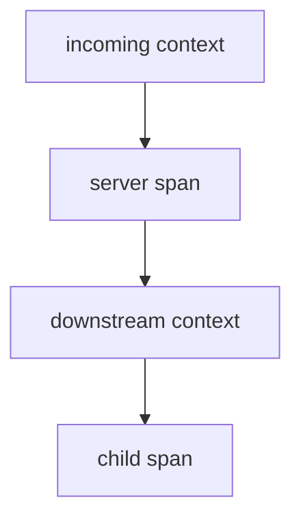

# A03.36 · request tracing

[Phase index](../README.md) · [Principal] · 25–40 minutes

Prerequisite [A03.35](A03.35.md) · Next [A03.37](A03.37.md)

## 1. The problem & why it exists

An error has a request ID but no useful cross-service causal path. Use established instrumentation, sample deliberately and avoid secrets in attributes.

## 2. Visual mental model



```text
1. incoming context
2. server span
3. downstream context
4. child span
```

The diagram isolates the mechanism on one request or process. Deployment limits and concurrent work can introduce additional boundaries.

## 3. Step-by-step mechanism & minimal dry-run

A trace groups spans; parent context connects causal work. Propagate standard trace headers and treat external trace metadata as untrusted input. Capture bounded attributes.

**Trace.** incoming context → server span → downstream context → child span.

Run the example twice. Identify the first state where the controlled failure changes the behavior or assumption.

## 4. Formal rigor & quantitative math

A 150 ms parent with overlapping child intervals [10,70] and [40,100] has 90 ms child coverage and 60 ms outside the union.

Verify the worked calculation with Python.

```python
import math

actual = 150 - len(set(range(10, 70)) | set(range(40, 100)))
assert math.isclose(actual, 60, rel_tol=1e-4)
print(actual)
```

## 5. Progressive design

| Control | Observable evidence | Trade-off |
| --- | --- | --- |
| Failure | `child ms: 30` | Find the boundary where the fixture's incorrect assumption becomes visible. |
| Normal | `child ms: 60` | Use established instrumentation, sample deliberately and avoid secrets in attributes. |

The [fixture](../examples/A03.36.py) is bounded. Check whether it runs the real runtime primitive or models a decision with fixed inputs before interpreting its output as production evidence.

## 6. Safe local lab & controlled failure injection

From the repository root, after `uv sync --locked --extra api`:

```sh
uv run --extra api python "01-architecture-A01-to-A20/A03-python-runtime-and-backend-apis/examples/A03.36.py"
uv run --extra api python "01-architecture-A01-to-A20/A03-python-runtime-and-backend-apis/examples/A03.36.py" --break
```

Predict both runs, measure the first difference, and rerun the normal control. Change one parameter in the worked example or one input to the fixture, recompute your expected result, and record any mismatch. Remove your scratch copy once you have the evidence. Continue to [L4](../labs/L4.md) for integration practice.

## 7. Production & multi-cloud bridge

Use established instrumentation, sample deliberately and avoid secrets in attributes. For a container deployment on Amazon EKS, Azure AKS or Google Kubernetes Engine, locate the boundary in application code, process configuration and any service in the request path. Collect evidence at the affected boundary before changing infrastructure.

<details>
<summary>Principal discussion</summary>

Is the sum of overlapping child durations the parent time? No. In a design review, state the observable signal that would confirm the diagnosis and name the owner of the boundary.

</details>

## 8. Memory hook & mastery checkpoint

1. Is the sum of overlapping child durations the parent time?
2. State the observation for each control and locate their first divergence.
3. Change the worked input and calculate the result before running the check.
4. Explain which decision in section 5 you would preserve in a larger deployment.
5. Explain one difference between this fixture and production behavior.

<details>
<summary>Check your answers</summary>

1. No.
2. Normal `child ms: 60`. Failure `child ms: 30`.
3. Apply the relationship in section 4 to the modified input. Verify the output with the same units.
4. Use established instrumentation, sample deliberately and avoid secrets in attributes.
5. A trace groups spans; parent context connects causal work. Propagate standard trace headers and treat external trace metadata as untrusted input. Capture bounded attributes.

</details>

## Standards and implementation notes

- [Primary specification or implementation documentation](https://www.w3.org/TR/trace-context/)
