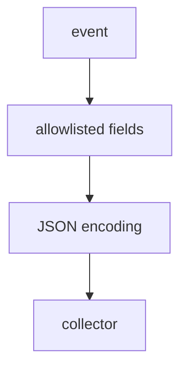

# A03.37 · structured logging

[Phase index](../README.md) · [Principal] · 25–40 minutes

Prerequisite [A03.36](A03.36.md) · Next [A03.38](A03.38.md)

## 1. The problem & why it exists

A production incident requires guessing IDs from unstructured messages. Log machine-readable events with bounded fields, and keep logs distinct from metrics.

## 2. Visual mental model



```text
1. event
2. allowlisted fields
3. JSON encoding
4. collector
```

The diagram isolates the mechanism on one request or process. Deployment limits and concurrent work can introduce additional boundaries.

## 3. Step-by-step mechanism & minimal dry-run

Emit stable structured fields for service, event, outcome and correlation. Avoid sensitive values and high-cardinality metric labels. Leave free-text detail for context.

**Trace.** event → allowlisted fields → JSON encoding → collector.

Run the example twice. Identify the first state where the controlled failure changes the behavior or assumption.

## 4. Formal rigor & quantitative math

At 400 B per record and 500 requests/s, one record per request produces 200000 B/s before compression.

Verify the worked calculation with Python.

```python
import math

actual = 400 * 500
assert math.isclose(actual, 200000, rel_tol=1e-4)
print(actual)
```

## 5. Progressive design

| Control | Observable evidence | Trade-off |
| --- | --- | --- |
| Failure | `authorization` | Find the boundary where the fixture's incorrect assumption becomes visible. |
| Normal | `request_complete` | Log machine-readable events with bounded fields, and keep logs distinct from metrics. |

The [fixture](../examples/A03.37.py) is bounded. Check whether it runs the real runtime primitive or models a decision with fixed inputs before interpreting its output as production evidence.

## 6. Safe local lab & controlled failure injection

From the repository root, after `uv sync --locked --extra api`:

```sh
uv run --extra api python "01-architecture-A01-to-A20/A03-python-runtime-and-backend-apis/examples/A03.37.py"
uv run --extra api python "01-architecture-A01-to-A20/A03-python-runtime-and-backend-apis/examples/A03.37.py" --break
```

Predict both runs, measure the first difference, and rerun the normal control. Change one parameter in the worked example or one input to the fixture, recompute your expected result, and record any mismatch. Remove your scratch copy once you have the evidence. Continue to [L4](../labs/L4.md) for integration practice.

## 7. Production & multi-cloud bridge

Log machine-readable events with bounded fields, and keep logs distinct from metrics. For a container deployment on Amazon EKS, Azure AKS or Google Kubernetes Engine, locate the boundary in application code, process configuration and any service in the request path. Collect evidence at the affected boundary before changing infrastructure.

<details>
<summary>Principal discussion</summary>

Should an Authorization header be logged? No. In a design review, state the observable signal that would confirm the diagnosis and name the owner of the boundary.

</details>

## 8. Memory hook & mastery checkpoint

1. Should an Authorization header be logged?
2. State the observation for each control and locate their first divergence.
3. Change the worked input and calculate the result before running the check.
4. Explain which decision in section 5 you would preserve in a larger deployment.
5. Explain one difference between this fixture and production behavior.

<details>
<summary>Check your answers</summary>

1. No.
2. Normal `request_complete`. Failure `authorization`.
3. Apply the relationship in section 4 to the modified input. Verify the output with the same units.
4. Log machine-readable events with bounded fields, and keep logs distinct from metrics.
5. Emit stable structured fields for service, event, outcome and correlation. Avoid sensitive values and high-cardinality metric labels. Leave free-text detail for context.

</details>

## Standards and implementation notes

- [Primary specification or implementation documentation](https://docs.python.org/3/library/logging.html)
