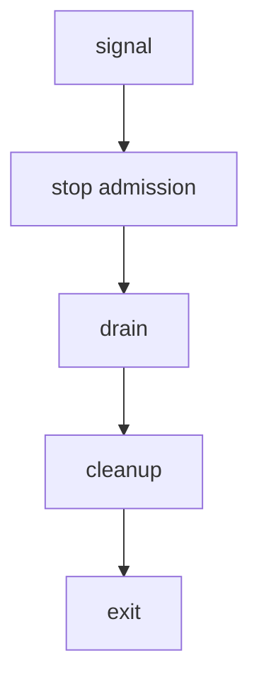

# A03.38 · graceful shutdown

[Phase index](../README.md) · [Principal] · 25–40 minutes

Prerequisite [A03.37](A03.37.md) · Next [A03.39](A03.39.md)

## 1. The problem & why it exists

A deploy sends termination while requests hold resources open. Align server and orchestrator grace windows and test requests in flight.

## 2. Visual mental model



```text
1. signal
2. stop admission
3. drain
4. cleanup
5. exit
```

The diagram isolates the mechanism on one request or process. Deployment limits and concurrent work can introduce additional boundaries.

## 3. Step-by-step mechanism & minimal dry-run

Stop accepting new work, drain in-flight requests within a grace period, cancel overdue work and close pools. Lifespan shutdown owns application cleanup; workers have separate lifecycles.

**Trace.** signal → stop admission → drain → cleanup → exit.

Run the example twice. Identify the first state where the controlled failure changes the behavior or assumption.

## 4. Formal rigor & quantitative math

If 5 s remains and resource cleanup requires 1 s, at most 4 s remains for draining under the model.

Verify the worked calculation with Python.

```python
import math

actual = 5 - 1
assert math.isclose(actual, 4, rel_tol=1e-4)
print(actual)
```

## 5. Progressive design

| Control | Observable evidence | Trade-off |
| --- | --- | --- |
| Failure | `open` | Find the boundary where the fixture's incorrect assumption becomes visible. |
| Normal | `close` | Align server and orchestrator grace windows and test requests in flight. |

The [fixture](../examples/A03.38.py) is bounded. Check whether it runs the real runtime primitive or models a decision with fixed inputs before interpreting its output as production evidence.

## 6. Safe local lab & controlled failure injection

From the repository root, after `uv sync --locked --extra api`:

```sh
uv run --extra api python "01-architecture-A01-to-A20/A03-python-runtime-and-backend-apis/examples/A03.38.py"
uv run --extra api python "01-architecture-A01-to-A20/A03-python-runtime-and-backend-apis/examples/A03.38.py" --break
```

Predict both runs, measure the first difference, and rerun the normal control. Change one parameter in the worked example or one input to the fixture, recompute your expected result, and record any mismatch. Remove your scratch copy once you have the evidence. Continue to [L4](../labs/L4.md) for integration practice.

## 7. Production & multi-cloud bridge

Align server and orchestrator grace windows and test requests in flight. For a container deployment on Amazon EKS, Azure AKS or Google Kubernetes Engine, locate the boundary in application code, process configuration and any service in the request path. Collect evidence at the affected boundary before changing infrastructure.

<details>
<summary>Principal discussion</summary>

Can unlimited draining block deploy completion? Yes. In a design review, state the observable signal that would confirm the diagnosis and name the owner of the boundary.

</details>

## 8. Memory hook & mastery checkpoint

1. Can unlimited draining block deploy completion?
2. State the observation for each control and locate their first divergence.
3. Change the worked input and calculate the result before running the check.
4. Explain which decision in section 5 you would preserve in a larger deployment.
5. Explain one difference between this fixture and production behavior.

<details>
<summary>Check your answers</summary>

1. Yes.
2. Normal `close`. Failure `open`.
3. Apply the relationship in section 4 to the modified input. Verify the output with the same units.
4. Align server and orchestrator grace windows and test requests in flight.
5. Stop accepting new work, drain in-flight requests within a grace period, cancel overdue work and close pools. Lifespan shutdown owns application cleanup; workers have separate lifecycles.

</details>

## Standards and implementation notes

- [Primary specification or implementation documentation](https://fastapi.tiangolo.com/advanced/events/)
