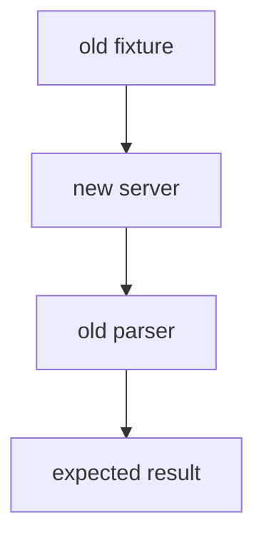

# A03.39 · API compatibility testing

[Phase index](../README.md) · [Principal] · 25–40 minutes

Prerequisite [A03.38](A03.38.md) · Next [A03.40](A03.40.md)

## 1. The problem & why it exists

An API change passes server tests and breaks the previously shipped client. Use stored consumer fixtures and test tolerant versus strict parsers explicitly.

## 2. Visual mental model



```text
1. old fixture
2. new server
3. old parser
4. expected result
```

The diagram isolates the mechanism on one request or process. Deployment limits and concurrent work can introduce additional boundaries.

## 3. Step-by-step mechanism & minimal dry-run

Check observable behavior with old and new contracts, including error shapes, defaults, nullability and encoding. Schema diffs are evidence and need executable compatibility tests.

**Trace.** old fixture → new server → old parser → expected result.

Run the example twice. Identify the first state where the controlled failure changes the behavior or assumption.

## 4. Formal rigor & quantitative math

Four consumer versions with five critical workflows produce 20 pairwise workflow checks against a candidate server.

Verify the worked calculation with Python.

```python
import math

actual = 4 * 5
assert math.isclose(actual, 20, rel_tol=1e-4)
print(actual)
```

## 5. Progressive design

| Control | Observable evidence | Trade-off |
| --- | --- | --- |
| Failure | `accepted: False` | Find the boundary where the fixture's incorrect assumption becomes visible. |
| Normal | `accepted: True` | Use stored consumer fixtures and test tolerant versus strict parsers explicitly. |

The [fixture](../examples/A03.39.py) is bounded. Check whether it runs the real runtime primitive or models a decision with fixed inputs before interpreting its output as production evidence.

## 6. Safe local lab & controlled failure injection

From the repository root, after `uv sync --locked --extra api`:

```sh
uv run --extra api python "01-architecture-A01-to-A20/A03-python-runtime-and-backend-apis/examples/A03.39.py"
uv run --extra api python "01-architecture-A01-to-A20/A03-python-runtime-and-backend-apis/examples/A03.39.py" --break
```

Predict both runs, measure the first difference, and rerun the normal control. Change one parameter in the worked example or one input to the fixture, recompute your expected result, and record any mismatch. Remove your scratch copy once you have the evidence. Continue to [L3](../labs/L3.md) for integration practice.

## 7. Production & multi-cloud bridge

Use stored consumer fixtures and test tolerant versus strict parsers explicitly. For a container deployment on Amazon EKS, Azure AKS or Google Kubernetes Engine, locate the boundary in application code, process configuration and any service in the request path. Collect evidence at the affected boundary before changing infrastructure.

<details>
<summary>Principal discussion</summary>

Can adding a response field be breaking? Yes, for a strict or code-generated consumer depending on its contract. In a design review, state the observable signal that would confirm the diagnosis and name the owner of the boundary.

</details>

## 8. Memory hook & mastery checkpoint

1. Can adding a response field be breaking?
2. State the observation for each control and locate their first divergence.
3. Change the worked input and calculate the result before running the check.
4. Explain which decision in section 5 you would preserve in a larger deployment.
5. Explain one difference between this fixture and production behavior.

<details>
<summary>Check your answers</summary>

1. Yes, for a strict or code-generated consumer depending on its contract.
2. Normal `accepted: True`. Failure `accepted: False`.
3. Apply the relationship in section 4 to the modified input. Verify the output with the same units.
4. Use stored consumer fixtures and test tolerant versus strict parsers explicitly.
5. Check observable behavior with old and new contracts, including error shapes, defaults, nullability and encoding. Schema diffs are evidence and need executable compatibility tests.

</details>

## Standards and implementation notes

- [Primary specification or implementation documentation](https://spec.openapis.org/oas/latest.html)
