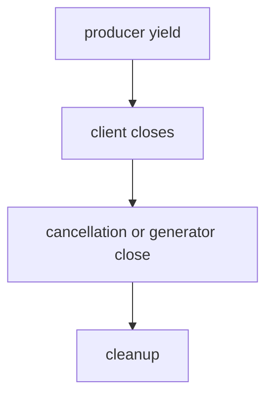

# A03.40 · streaming and event cancellation

[Phase index](../README.md) · [Principal] · 25–40 minutes

Prerequisite [A03.39](A03.39.md) · Next [A03.41](A03.41.md)

## 1. The problem & why it exists

A client drops a stream but the backend keeps producing events. Use a bounded stream and test interruption before completion.

## 2. Visual mental model



```text
1. producer yield
2. client closes
3. cancellation or generator close
4. cleanup
```

The diagram isolates the mechanism on one request or process. Deployment limits and concurrent work can introduce additional boundaries.

## 3. Step-by-step mechanism & minimal dry-run

Transport disconnect and task cancellation are signals to stop production and release resources. Await downstream writes to preserve backpressure and use finally to clean up.

**Trace.** producer yield → client closes → cancellation or generator close → cleanup.

Run the example twice. Identify the first state where the controlled failure changes the behavior or assumption.

## 4. Formal rigor & quantitative math

At c chunks/s with d seconds before cleanup, wasted production can reach c×d chunks. At 20/s for 3 s that is 60 chunks.

Verify the worked calculation with Python.

```python
import math

actual = 20 * 3
assert math.isclose(actual, 60, rel_tol=1e-4)
print(actual)
```

## 5. Progressive design

| Control | Observable evidence | Trade-off |
| --- | --- | --- |
| Failure | `deferred cleanup` | Find the boundary where the fixture's incorrect assumption becomes visible. |
| Normal | `cleanup observed before return` | Use a bounded stream and test interruption before completion. |

The [fixture](../examples/A03.40.py) is bounded. Check whether it runs the real runtime primitive or models a decision with fixed inputs before interpreting its output as production evidence.

## 6. Safe local lab & controlled failure injection

From the repository root, after `uv sync --locked --extra api`:

```sh
uv run --extra api python "01-architecture-A01-to-A20/A03-python-runtime-and-backend-apis/examples/A03.40.py"
uv run --extra api python "01-architecture-A01-to-A20/A03-python-runtime-and-backend-apis/examples/A03.40.py" --break
```

Predict both runs, measure the first difference, and rerun the normal control. Change one parameter in the worked example or one input to the fixture, recompute your expected result, and record any mismatch. Remove your scratch copy once you have the evidence. Continue to [L2](../labs/L2.md) for integration practice.

## 7. Production & multi-cloud bridge

Use a bounded stream and test interruption before completion. For a container deployment on Amazon EKS, Azure AKS or Google Kubernetes Engine, locate the boundary in application code, process configuration and any service in the request path. Collect evidence at the affected boundary before changing infrastructure.

<details>
<summary>Principal discussion</summary>

Does returning a streaming response mean every chunk reached the client? No. In a design review, state the observable signal that would confirm the diagnosis and name the owner of the boundary.

</details>

## 8. Memory hook & mastery checkpoint

1. Does returning a streaming response mean every chunk reached the client?
2. State the observation for each control and locate their first divergence.
3. Change the worked input and calculate the result before running the check.
4. Explain which decision in section 5 you would preserve in a larger deployment.
5. Explain one difference between this fixture and production behavior.

<details>
<summary>Check your answers</summary>

1. No.
2. Normal `cleanup observed before return`. Failure `deferred cleanup`.
3. Apply the relationship in section 4 to the modified input. Verify the output with the same units.
4. Use a bounded stream and test interruption before completion.
5. Transport disconnect and task cancellation are signals to stop production and release resources. Await downstream writes to preserve backpressure and use finally to clean up.

</details>

## Standards and implementation notes

- [Primary specification or implementation documentation](https://asgi.readthedocs.io/en/latest/specs/www.html)
