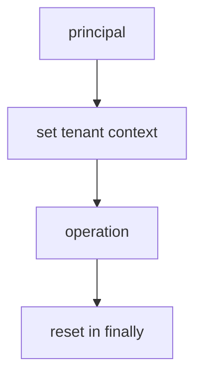

# A03.41 · multi-tenant context propagation

[Phase index](../README.md) · [Principal] · 25–40 minutes

Prerequisite [A03.40](A03.40.md) · Next [A03.42](A03.42.md)

## 1. The problem & why it exists

An async service leaks tenant context between consecutive requests. Authorize and scope database operations explicitly; ambient context is useful for correlation.

## 2. Visual mental model



```text
1. principal
2. set tenant context
3. operation
4. reset in finally
```

The diagram isolates the mechanism on one request or process. Deployment limits and concurrent work can introduce additional boundaries.

## 3. Step-by-step mechanism & minimal dry-run

Derive tenant from authentication, qualify every resource operation, and restore request-local context using ContextVar tokens. Spawned tasks copy context, so background job ownership needs care.

**Trace.** principal → set tenant context → operation → reset in finally.

Run the example twice. Identify the first state where the controlled failure changes the behavior or assumption.

## 4. Formal rigor & quantitative math

For n tenants with identical record IDs, identifier-only storage collapses n identities into one. A tuple of tenant and ID leaves n distinct keys.

Verify the worked calculation with Python.

```python
import math

actual = len({(tenant, 1) for tenant in ("a", "b", "c")})
assert math.isclose(actual, 3, rel_tol=1e-4)
print(actual)
```

## 5. Progressive design

| Control | Observable evidence | Trade-off |
| --- | --- | --- |
| Failure | `sees: tenant-a` | Find the boundary where the fixture's incorrect assumption becomes visible. |
| Normal | `sees: None` | Authorize and scope database operations explicitly; ambient context is useful for correlation. |

The [fixture](../examples/A03.41.py) is bounded. Check whether it runs the real runtime primitive or models a decision with fixed inputs before interpreting its output as production evidence.

## 6. Safe local lab & controlled failure injection

From the repository root, after `uv sync --locked --extra api`:

```sh
uv run --extra api python "01-architecture-A01-to-A20/A03-python-runtime-and-backend-apis/examples/A03.41.py"
uv run --extra api python "01-architecture-A01-to-A20/A03-python-runtime-and-backend-apis/examples/A03.41.py" --break
```

Predict both runs, measure the first difference, and rerun the normal control. Change one parameter in the worked example or one input to the fixture, recompute your expected result, and record any mismatch. Remove your scratch copy once you have the evidence. Continue to [L3](../labs/L3.md) for integration practice.

## 7. Production & multi-cloud bridge

Authorize and scope database operations explicitly; ambient context is useful for correlation. For a container deployment on Amazon EKS, Azure AKS or Google Kubernetes Engine, locate the boundary in application code, process configuration and any service in the request path. Collect evidence at the affected boundary before changing infrastructure.

<details>
<summary>Principal discussion</summary>

Can a caller-supplied tenant header establish identity by itself? No. In a design review, state the observable signal that would confirm the diagnosis and name the owner of the boundary.

</details>

## 8. Memory hook & mastery checkpoint

1. Can a caller-supplied tenant header establish identity by itself?
2. State the observation for each control and locate their first divergence.
3. Change the worked input and calculate the result before running the check.
4. Explain which decision in section 5 you would preserve in a larger deployment.
5. Explain one difference between this fixture and production behavior.

<details>
<summary>Check your answers</summary>

1. No.
2. Normal `sees: None`. Failure `sees: tenant-a`.
3. Apply the relationship in section 4 to the modified input. Verify the output with the same units.
4. Authorize and scope database operations explicitly; ambient context is useful for correlation.
5. Derive tenant from authentication, qualify every resource operation, and restore request-local context using ContextVar tokens. Spawned tasks copy context, so background job ownership needs care.

</details>

## Standards and implementation notes

- [Primary specification or implementation documentation](https://docs.python.org/3/library/contextvars.html)
