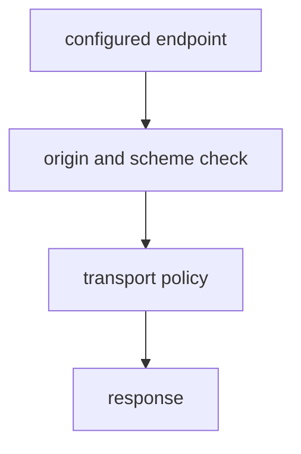

# A03.42 · secure client libraries

[Phase index](../README.md) · [Principal] · 25–40 minutes

Prerequisite [A03.41](A03.41.md) · Next [Exit gate](../README.md#practice-and-exit-gate)

## 1. The problem & why it exists

A client forwards credentials on a redirect and accepts an unexpected endpoint. Use a maintained client with TLS verification and a clearly bounded destination policy.

## 2. Visual mental model



```text
1. configured endpoint
2. origin and scheme check
3. transport policy
4. response
```

The diagram isolates the mechanism on one request or process. Deployment limits and concurrent work can introduce additional boundaries.

## 3. Step-by-step mechanism & minimal dry-run

Keep transport verification enabled and pin allowed destination policy to the intended origin, with explicit redirect handling. Use bounded timeouts and avoid credentials in logs. A real remote fetcher also needs DNS and address policy.

**Trace.** configured endpoint → origin and scheme check → transport policy → response.

Run the example twice. Identify the first state where the controlled failure changes the behavior or assumption.

## 4. Formal rigor & quantitative math

A policy allowing one origin rejects all other origins in the fixture. A redirect limit r bounds the maximum request hops to r+1 under simple semantics.

Verify the worked calculation with Python.

```python
import math

actual = 2 + 1
assert math.isclose(actual, 3, rel_tol=1e-4)
print(actual)
```

## 5. Progressive design

| Control | Observable evidence | Trade-off |
| --- | --- | --- |
| Failure | `accepts: True` | Find the boundary where the fixture's incorrect assumption becomes visible. |
| Normal | `accepts: False` | Use a maintained client with TLS verification and a clearly bounded destination policy. |

The [fixture](../examples/A03.42.py) is bounded. Check whether it runs the real runtime primitive or models a decision with fixed inputs before interpreting its output as production evidence.

## 6. Safe local lab & controlled failure injection

From the repository root, after `uv sync --locked --extra api`:

```sh
uv run --extra api python "01-architecture-A01-to-A20/A03-python-runtime-and-backend-apis/examples/A03.42.py"
uv run --extra api python "01-architecture-A01-to-A20/A03-python-runtime-and-backend-apis/examples/A03.42.py" --break
```

Predict both runs, measure the first difference, and rerun the normal control. Change one parameter in the worked example or one input to the fixture, recompute your expected result, and record any mismatch. Remove your scratch copy once you have the evidence. Continue to [L3](../labs/L3.md) for integration practice.

## 7. Production & multi-cloud bridge

Use a maintained client with TLS verification and a clearly bounded destination policy. For a container deployment on Amazon EKS, Azure AKS or Google Kubernetes Engine, locate the boundary in application code, process configuration and any service in the request path. Collect evidence at the affected boundary before changing infrastructure.

<details>
<summary>Principal discussion</summary>

Does a matching hostname alone guarantee a safe redirect target? No, scheme, effective port and redirect policy matter. In a design review, state the observable signal that would confirm the diagnosis and name the owner of the boundary.

</details>

## 8. Memory hook & mastery checkpoint

1. Does a matching hostname alone guarantee a safe redirect target?
2. State the observation for each control and locate their first divergence.
3. Change the worked input and calculate the result before running the check.
4. Explain which decision in section 5 you would preserve in a larger deployment.
5. Explain one difference between this fixture and production behavior.

<details>
<summary>Check your answers</summary>

1. No, scheme, effective port and redirect policy matter.
2. Normal `accepts: False`. Failure `accepts: True`.
3. Apply the relationship in section 4 to the modified input. Verify the output with the same units.
4. Use a maintained client with TLS verification and a clearly bounded destination policy.
5. Keep transport verification enabled and pin allowed destination policy to the intended origin, with explicit redirect handling. Use bounded timeouts and avoid credentials in logs. A real remote fetcher also needs DNS and address policy.

</details>

## Standards and implementation notes

- [Primary specification or implementation documentation](https://www.python-httpx.org/advanced/clients/)
- [HTTPX SSL verification](https://www.python-httpx.org/advanced/ssl/)
- [HTTP semantics](https://www.rfc-editor.org/rfc/rfc9110.html)
