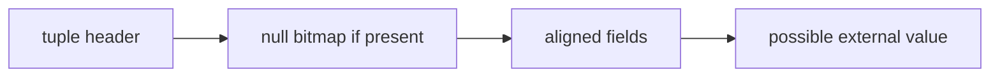

# A04.02 · record layouts

[Phase index](../README.md) · [Foundation] · 25–40 minutes

Prerequisite [A04.01](A04.01.md) · Next [A04.03](A04.03.md)

## 1. The problem & why it exists

Adding a nullable column changes stored size in a surprising way. Use representative values and measure the actual stored layout before relying on byte counts.

## 2. Visual mental model



```text
01. tuple header
02. null bitmap if present
03. aligned fields
04. possible external value
```

Follow the responsibilities in order. The fixture isolates one mechanism. Check the engine and observation point before attributing the result to an actual deployment.

## 3. Step-by-step mechanism & minimal dry-run

Record encodings can include a null bitmap, headers, alignment padding and variable-length fields. PostgreSQL can compress or store large values out of line using TOAST.

**Trace.** tuple header → null bitmap if present → aligned fields → possible external value.

## 4. Formal rigor & quantitative math

Two fields of 1 B and 8 B with 8 B alignment occupy 16 B when the small field comes first, excluding record metadata.

Predict the worked quantities by hand, then run the [example](../examples/A04.02.py). It uses a small calculation or state model. For arithmetic, retain the units attached to the worked formula.

## 5. Progressive design

| Run | Expected fixture result | Interpretation |
| --- | --- | --- |
| Failure control | `9` | Which assumption from the opening problem leads to this result? |
| Normal control | `16` | Use representative values and measure the actual stored layout before relying on byte counts. |

When the fixture reports a modeled value, use the lab to check the corresponding engine behavior. Compare work per request, retained bytes, and operational consequences only where the model measures them.

## 6. Safe local lab & controlled failure injection

```sh
uv run python "01-architecture-A01-to-A20/A04-databases-sql-and-storage-engines/examples/A04.02.py"
uv run python "01-architecture-A01-to-A20/A04-databases-sql-and-storage-engines/examples/A04.02.py" --break
```

Predict both results and identify which input or branch changes. Rerun the normal control as a repair. In a scratch copy, change one key, bound or assumption and predict the result again. Remove the scratch copy after recording your evidence. Apply this reasoning in [L1](../labs/L1.md).

## 7. Production & multi-cloud bridge

Use representative values and measure the actual stored layout before relying on byte counts. For deployments on AWS, Azure or Google Cloud, confirm engine version, responsibility for maintenance and which metrics the service exposes. Run production comparisons with the same query mix and recovery objective.

<details>
<summary>Principal question and answer</summary>

What evidence would distinguish the opening failure from a storage-capacity problem? Start with the first divergent boundary in the trace and name the exact mechanism. Record encodings can include a null bitmap, headers, alignment padding and variable-length fields. PostgreSQL can compress or store large values out of line using TOAST.

</details>

## 8. Memory hook & mastery checkpoint

1. Name the operation at the first stage in the trace.
2. Explain the normal and broken outputs before running them.
3. Change one input and compute the revised result with units.
4. How would you test this boundary at deployment scale?
5. What is one assumption that limits the fixture?

<details>
<summary>Check your reasoning</summary>

1. tuple header.
2. Normal `16`. Failure `9`.
3. Reapply the relationship in section 4 to your changed inputs.
4. Use representative values and measure the actual stored layout before relying on byte counts.
5. The example uses a small calculation or state model. Check the primary reference for behavior outside that scope.

</details>

## Standards and implementation notes

- [Primary reference](https://www.postgresql.org/docs/current/storage-toast.html)
