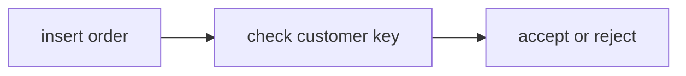

# A04.03 · relational tables, keys and constraints

[Phase index](../README.md) · [Foundation] · 25–40 minutes

Prerequisite [A04.02](A04.02.md) · Next [A04.04](A04.04.md)

## 1. The problem & why it exists

Two orders point at a customer that was never created. Enforce invariants at the database boundary so all writers share the same rules.

## 2. Visual mental model



```text
01. insert order
02. check customer key
03. accept or reject
```

Follow the responsibilities in order. The fixture isolates one mechanism. Check the engine and observation point before attributing the result to an actual deployment.

## 3. Step-by-step mechanism & minimal dry-run

A primary key identifies a row. A unique constraint restricts duplicates, and a foreign key checks referenced identity. CHECK and NOT NULL protect different conditions. A CHECK that yields NULL is not a substitute for NOT NULL.

**Trace.** insert order → check customer key → accept or reject.

## 4. Formal rigor & quantitative math

One customer can own n orders while each order references one customer. Four customers with two orders each imply eight order rows.

Predict the worked quantities by hand, then run the [example](../examples/A04.03.py). It uses an actual SQLite SQL statement. For arithmetic, retain the units attached to the worked formula.

## 5. Progressive design

| Run | Expected fixture result | Interpretation |
| --- | --- | --- |
| Failure control | `1` | Which assumption from the opening problem leads to this result? |
| Normal control | `'rejected'` | Enforce invariants at the database boundary so all writers share the same rules. |

When the fixture reports a modeled value, use the lab to check the corresponding engine behavior. Compare work per request, retained bytes, and operational consequences only where the model measures them.

## 6. Safe local lab & controlled failure injection

```sh
uv run python "01-architecture-A01-to-A20/A04-databases-sql-and-storage-engines/examples/A04.03.py"
uv run python "01-architecture-A01-to-A20/A04-databases-sql-and-storage-engines/examples/A04.03.py" --break
```

Predict both results and identify which input or branch changes. Rerun the normal control as a repair. In a scratch copy, change one key, bound or assumption and predict the result again. Remove the scratch copy after recording your evidence. Apply this reasoning in [L1](../labs/L1.md).

## 7. Production & multi-cloud bridge

Enforce invariants at the database boundary so all writers share the same rules. For deployments on AWS, Azure or Google Cloud, confirm engine version, responsibility for maintenance and which metrics the service exposes. Run production comparisons with the same query mix and recovery objective.

<details>
<summary>Principal question and answer</summary>

What evidence would distinguish the opening failure from a storage-capacity problem? Start with the first divergent boundary in the trace and name the exact mechanism. A primary key identifies a row. A unique constraint restricts duplicates, and a foreign key checks referenced identity. CHECK and NOT NULL protect different conditions. A CHECK that yields NULL is not a substitute for NOT NULL.

</details>

## 8. Memory hook & mastery checkpoint

1. Name the operation at the first stage in the trace.
2. Explain the normal and broken outputs before running them.
3. Change one input and compute the revised result with units.
4. How would you test this boundary at deployment scale?
5. What is one assumption that limits the fixture?

<details>
<summary>Check your reasoning</summary>

1. insert order.
2. Normal `'rejected'`. Failure `1`.
3. Reapply the relationship in section 4 to your changed inputs.
4. Enforce invariants at the database boundary so all writers share the same rules.
5. The example uses an actual SQLite SQL statement. Check the primary reference for behavior outside that scope.

</details>

## Standards and implementation notes

- [Primary reference](https://www.postgresql.org/docs/current/ddl-constraints.html)
