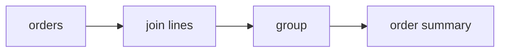

# A04.05 · SQL operations

[Phase index](../README.md) · [Foundation] · 25–40 minutes

Prerequisite [A04.04](A04.04.md) · Next [A04.06](A04.06.md)

## 1. The problem & why it exists

A report counts rows twice after joining a one-to-many table. Choose the aggregation grain before joining; use EXISTS when only membership matters.

## 2. Visual mental model



```text
01. orders
02. join lines
03. group
04. order summary
```

Follow the responsibilities in order. The fixture isolates one mechanism. Check the engine and observation point before attributing the result to an actual deployment.

## 3. Step-by-step mechanism & minimal dry-run

JOIN determines combinations, WHERE filters rows, GROUP BY splits sets for aggregation, and ORDER BY controls output order. SQL commonly preserves duplicates unless removed explicitly.

**Trace.** orders → join lines → group → order summary.

## 4. Formal rigor & quantitative math

Three orders with two lines each yield six matched rows; COUNT(DISTINCT order_id) yields three order IDs.

Predict the worked quantities by hand, then run the [example](../examples/A04.05.py). It uses an actual SQLite SQL statement. For arithmetic, retain the units attached to the worked formula.

## 5. Progressive design

| Run | Expected fixture result | Interpretation |
| --- | --- | --- |
| Failure control | `6` | Which assumption from the opening problem leads to this result? |
| Normal control | `3` | Choose the aggregation grain before joining; use EXISTS when only membership matters. |

When the fixture reports a modeled value, use the lab to check the corresponding engine behavior. Compare work per request, retained bytes, and operational consequences only where the model measures them.

## 6. Safe local lab & controlled failure injection

```sh
uv run python "01-architecture-A01-to-A20/A04-databases-sql-and-storage-engines/examples/A04.05.py"
uv run python "01-architecture-A01-to-A20/A04-databases-sql-and-storage-engines/examples/A04.05.py" --break
```

Predict both results and identify which input or branch changes. Rerun the normal control as a repair. In a scratch copy, change one key, bound or assumption and predict the result again. Remove the scratch copy after recording your evidence. Apply this reasoning in [L1](../labs/L1.md).

## 7. Production & multi-cloud bridge

Choose the aggregation grain before joining; use EXISTS when only membership matters. For deployments on AWS, Azure or Google Cloud, confirm engine version, responsibility for maintenance and which metrics the service exposes. Run production comparisons with the same query mix and recovery objective.

<details>
<summary>Principal question and answer</summary>

What evidence would distinguish the opening failure from a storage-capacity problem? Start with the first divergent boundary in the trace and name the exact mechanism. JOIN determines combinations, WHERE filters rows, GROUP BY splits sets for aggregation, and ORDER BY controls output order. SQL commonly preserves duplicates unless removed explicitly.

</details>

## 8. Memory hook & mastery checkpoint

1. Name the operation at the first stage in the trace.
2. Explain the normal and broken outputs before running them.
3. Change one input and compute the revised result with units.
4. How would you test this boundary at deployment scale?
5. What is one assumption that limits the fixture?

<details>
<summary>Check your reasoning</summary>

1. orders.
2. Normal `3`. Failure `6`.
3. Reapply the relationship in section 4 to your changed inputs.
4. Choose the aggregation grain before joining; use EXISTS when only membership matters.
5. The example uses an actual SQLite SQL statement. Check the primary reference for behavior outside that scope.

</details>

## Standards and implementation notes

- [Primary reference](https://www.postgresql.org/docs/current/queries-table-expressions.html)
