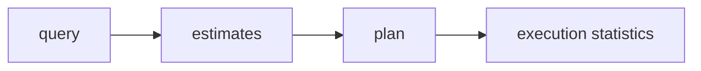

# A04.06 · query plans

[Phase index](../README.md) · [Foundation] · 25–40 minutes

Prerequisite [A04.05](A04.05.md) · Next [A04.07](A04.07.md)

## 1. The problem & why it exists

An index exists but the planner chooses a sequential scan. Compare estimates with actuals and buffer evidence. Avoid forcing a plan from one tiny fixture.

## 2. Visual mental model



```text
01. query
02. estimates
03. plan
04. execution statistics
```

Follow the responsibilities in order. The fixture isolates one mechanism. Check the engine and observation point before attributing the result to an actual deployment.

## 3. Step-by-step mechanism & minimal dry-run

A planner estimates row counts and costs, then chooses scan, join and aggregation nodes. Actual timings and row counts require EXPLAIN ANALYZE, which executes the statement.

**Trace.** query → estimates → plan → execution statistics.

## 4. Formal rigor & quantitative math

For n=100000 rows and p=0.001 selectivity, estimated matching rows are np=100. A bad estimate of 0.1 predicts 10000.

Predict the worked quantities by hand, then run the [example](../examples/A04.06.py). It uses a small calculation or state model. For arithmetic, retain the units attached to the worked formula.

## 5. Progressive design

| Run | Expected fixture result | Interpretation |
| --- | --- | --- |
| Failure control | `10000` | Which assumption from the opening problem leads to this result? |
| Normal control | `100` | Compare estimates with actuals and buffer evidence. Avoid forcing a plan from one tiny fixture. |

When the fixture reports a modeled value, use the lab to check the corresponding engine behavior. Compare work per request, retained bytes, and operational consequences only where the model measures them.

## 6. Safe local lab & controlled failure injection

```sh
uv run python "01-architecture-A01-to-A20/A04-databases-sql-and-storage-engines/examples/A04.06.py"
uv run python "01-architecture-A01-to-A20/A04-databases-sql-and-storage-engines/examples/A04.06.py" --break
```

Predict both results and identify which input or branch changes. Rerun the normal control as a repair. In a scratch copy, change one key, bound or assumption and predict the result again. Remove the scratch copy after recording your evidence. Apply this reasoning in [L1](../labs/L1.md).

## 7. Production & multi-cloud bridge

Compare estimates with actuals and buffer evidence. Avoid forcing a plan from one tiny fixture. For deployments on AWS, Azure or Google Cloud, confirm engine version, responsibility for maintenance and which metrics the service exposes. Run production comparisons with the same query mix and recovery objective.

<details>
<summary>Principal question and answer</summary>

What evidence would distinguish the opening failure from a storage-capacity problem? Start with the first divergent boundary in the trace and name the exact mechanism. A planner estimates row counts and costs, then chooses scan, join and aggregation nodes. Actual timings and row counts require EXPLAIN ANALYZE, which executes the statement.

</details>

## 8. Memory hook & mastery checkpoint

1. Name the operation at the first stage in the trace.
2. Explain the normal and broken outputs before running them.
3. Change one input and compute the revised result with units.
4. How would you test this boundary at deployment scale?
5. What is one assumption that limits the fixture?

<details>
<summary>Check your reasoning</summary>

1. query.
2. Normal `100`. Failure `10000`.
3. Reapply the relationship in section 4 to your changed inputs.
4. Compare estimates with actuals and buffer evidence. Avoid forcing a plan from one tiny fixture.
5. The example uses a small calculation or state model. Check the primary reference for behavior outside that scope.

</details>

## Standards and implementation notes

- [Primary reference](https://www.postgresql.org/docs/current/using-explain.html)
