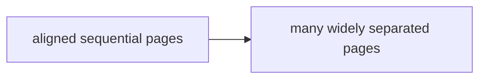

# A04.07 · disk seek and random vs sequential I/O

[Phase index](../README.md) · [Foundation] · 25–40 minutes

Prerequisite [A04.06](A04.06.md) · Next [A04.08](A04.08.md)

## 1. The problem & why it exists

Small scattered fetches saturate storage while a wider scan succeeds. Measure storage and cache conditions rather than using HDD assumptions for every device.

## 2. Visual mental model



```text
01. aligned sequential pages
02. many widely separated pages
```

Follow the responsibilities in order. The fixture isolates one mechanism. Check the engine and observation point before attributing the result to an actual deployment.

## 3. Step-by-step mechanism & minimal dry-run

HDD seeks add mechanical delay. SSDs remove mechanical seeking but throughput still depends on locality, request size and queue depth. Cache hits avoid device reads.

**Trace.** aligned sequential pages versus many widely separated pages.

## 4. Formal rigor & quantitative math

At 4 ms per independent serialized random read, 1000 reads take 4 s; reading 4 MiB at 200 MiB/s takes 20 ms, ignoring setup.

Predict the worked quantities by hand, then run the [example](../examples/A04.07.py). It uses a small calculation or state model. For arithmetic, retain the units attached to the worked formula.

## 5. Progressive design

| Run | Expected fixture result | Interpretation |
| --- | --- | --- |
| Failure control | `4000` | Which assumption from the opening problem leads to this result? |
| Normal control | `20.0` | Measure storage and cache conditions rather than using HDD assumptions for every device. |

When the fixture reports a modeled value, use the lab to check the corresponding engine behavior. Compare work per request, retained bytes, and operational consequences only where the model measures them.

## 6. Safe local lab & controlled failure injection

```sh
uv run python "01-architecture-A01-to-A20/A04-databases-sql-and-storage-engines/examples/A04.07.py"
uv run python "01-architecture-A01-to-A20/A04-databases-sql-and-storage-engines/examples/A04.07.py" --break
```

Predict both results and identify which input or branch changes. Rerun the normal control as a repair. In a scratch copy, change one key, bound or assumption and predict the result again. Remove the scratch copy after recording your evidence. Apply this reasoning in [L1](../labs/L1.md).

## 7. Production & multi-cloud bridge

Measure storage and cache conditions rather than using HDD assumptions for every device. For deployments on AWS, Azure or Google Cloud, confirm engine version, responsibility for maintenance and which metrics the service exposes. Run production comparisons with the same query mix and recovery objective.

<details>
<summary>Principal question and answer</summary>

What evidence would distinguish the opening failure from a storage-capacity problem? Start with the first divergent boundary in the trace and name the exact mechanism. HDD seeks add mechanical delay. SSDs remove mechanical seeking but throughput still depends on locality, request size and queue depth. Cache hits avoid device reads.

</details>

## 8. Memory hook & mastery checkpoint

1. Name the operation at the first stage in the trace.
2. Explain the normal and broken outputs before running them.
3. Change one input and compute the revised result with units.
4. How would you test this boundary at deployment scale?
5. What is one assumption that limits the fixture?

<details>
<summary>Check your reasoning</summary>

1. aligned sequential pages.
2. Normal `20.0`. Failure `4000`.
3. Reapply the relationship in section 4 to your changed inputs.
4. Measure storage and cache conditions rather than using HDD assumptions for every device.
5. The example uses a small calculation or state model. Check the primary reference for behavior outside that scope.

</details>

## Standards and implementation notes

- [Primary reference](https://www.postgresql.org/docs/current/using-explain.html)
