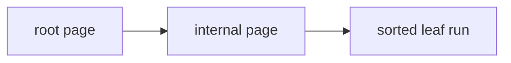

# A04.09 · B-tree and B+tree intuition

[Phase index](../README.md) · [Foundation] · 25–40 minutes

Prerequisite [A04.08](A04.08.md) · Next [A04.10](A04.10.md)

## 1. The problem & why it exists

A developer models an on-disk B-tree as a binary tree. Use B-tree indexes for ordered point and range access; account for page and key sizes.

## 2. Visual mental model



```text
01. root page
02. internal page
03. sorted leaf run
```

Follow the responsibilities in order. The fixture isolates one mechanism. Check the engine and observation point before attributing the result to an actual deployment.

## 3. Step-by-step mechanism & minimal dry-run

High fanout lets index pages narrow a large search range in few levels. A B+tree-style model puts searchable row references at leaves and uses internal separator keys.

**Trace.** root page → internal page → sorted leaf run.

## 4. Formal rigor & quantitative math

For fanout f=100 and h=3 child selections, the idealized tree addresses f^h=1000000 leaves. Actual occupancy is smaller after splits and deletes.

Predict the worked quantities by hand, then run the [example](../examples/A04.09.py). It uses a small calculation or state model. For arithmetic, retain the units attached to the worked formula.

## 5. Progressive design

| Run | Expected fixture result | Interpretation |
| --- | --- | --- |
| Failure control | `8` | Which assumption from the opening problem leads to this result? |
| Normal control | `1000000` | Use B-tree indexes for ordered point and range access; account for page and key sizes. |

When the fixture reports a modeled value, use the lab to check the corresponding engine behavior. Compare work per request, retained bytes, and operational consequences only where the model measures them.

## 6. Safe local lab & controlled failure injection

```sh
uv run python "01-architecture-A01-to-A20/A04-databases-sql-and-storage-engines/examples/A04.09.py"
uv run python "01-architecture-A01-to-A20/A04-databases-sql-and-storage-engines/examples/A04.09.py" --break
```

Predict both results and identify which input or branch changes. Rerun the normal control as a repair. In a scratch copy, change one key, bound or assumption and predict the result again. Remove the scratch copy after recording your evidence. Apply this reasoning in [L1](../labs/L1.md).

## 7. Production & multi-cloud bridge

Use B-tree indexes for ordered point and range access; account for page and key sizes. For deployments on AWS, Azure or Google Cloud, confirm engine version, responsibility for maintenance and which metrics the service exposes. Run production comparisons with the same query mix and recovery objective.

<details>
<summary>Principal question and answer</summary>

What evidence would distinguish the opening failure from a storage-capacity problem? Start with the first divergent boundary in the trace and name the exact mechanism. High fanout lets index pages narrow a large search range in few levels. A B+tree-style model puts searchable row references at leaves and uses internal separator keys.

</details>

## 8. Memory hook & mastery checkpoint

1. Name the operation at the first stage in the trace.
2. Explain the normal and broken outputs before running them.
3. Change one input and compute the revised result with units.
4. How would you test this boundary at deployment scale?
5. What is one assumption that limits the fixture?

<details>
<summary>Check your reasoning</summary>

1. root page.
2. Normal `1000000`. Failure `8`.
3. Reapply the relationship in section 4 to your changed inputs.
4. Use B-tree indexes for ordered point and range access; account for page and key sizes.
5. The example uses a small calculation or state model. Check the primary reference for behavior outside that scope.

</details>

## Standards and implementation notes

- [Primary reference](https://www.postgresql.org/docs/current/btree.html)
