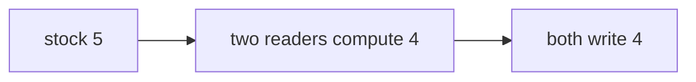

# A04.13 · lost updates/phantoms

[Phase index](../README.md) · [Core] · 25–40 minutes

Prerequisite [A04.12](A04.12.md) · Next [A04.14](A04.14.md)

## 1. The problem & why it exists

Two buyers decrement stock using stale values and oversell. Use a conditional atomic UPDATE or explicit locking, and verify predicate-based invariants at the right isolation level.

## 2. Visual mental model



```text
01. stock 5
02. two readers compute 4
03. both write 4
```

Follow the responsibilities in order. The fixture isolates one mechanism. Check the engine and observation point before attributing the result to an actual deployment.

## 3. Step-by-step mechanism & minimal dry-run

A read-modify-write can lose another writer's update when it writes an old calculated constant. A phantom is a change in rows matching a predicate. Test both anomalies separately.

**Trace.** stock 5 → two readers compute 4 → both write 4.

## 4. Formal rigor & quantitative math

Two successful decrements from 5 should leave 3. Last-write-wins from stale inputs leaves 4.

Predict the worked quantities by hand, then run the [example](../examples/A04.13.py). It uses a small calculation or state model. For arithmetic, retain the units attached to the worked formula.

## 5. Progressive design

| Run | Expected fixture result | Interpretation |
| --- | --- | --- |
| Failure control | `4` | Which assumption from the opening problem leads to this result? |
| Normal control | `3` | Use a conditional atomic UPDATE or explicit locking, and verify predicate-based invariants at the right isolation level. |

When the fixture reports a modeled value, use the lab to check the corresponding engine behavior. Compare work per request, retained bytes, and operational consequences only where the model measures them.

## 6. Safe local lab & controlled failure injection

```sh
uv run python "01-architecture-A01-to-A20/A04-databases-sql-and-storage-engines/examples/A04.13.py"
uv run python "01-architecture-A01-to-A20/A04-databases-sql-and-storage-engines/examples/A04.13.py" --break
```

Predict both results and identify which input or branch changes. Rerun the normal control as a repair. In a scratch copy, change one key, bound or assumption and predict the result again. Remove the scratch copy after recording your evidence. Apply this reasoning in [L2](../labs/L2.md).

## 7. Production & multi-cloud bridge

Use a conditional atomic UPDATE or explicit locking, and verify predicate-based invariants at the right isolation level. For deployments on AWS, Azure or Google Cloud, confirm engine version, responsibility for maintenance and which metrics the service exposes. Run production comparisons with the same query mix and recovery objective.

<details>
<summary>Principal question and answer</summary>

What evidence would distinguish the opening failure from a storage-capacity problem? Start with the first divergent boundary in the trace and name the exact mechanism. A read-modify-write can lose another writer's update when it writes an old calculated constant. A phantom is a change in rows matching a predicate. Test both anomalies separately.

</details>

## 8. Memory hook & mastery checkpoint

1. Name the operation at the first stage in the trace.
2. Explain the normal and broken outputs before running them.
3. Change one input and compute the revised result with units.
4. How would you test this boundary at deployment scale?
5. What is one assumption that limits the fixture?

<details>
<summary>Check your reasoning</summary>

1. stock 5.
2. Normal `3`. Failure `4`.
3. Reapply the relationship in section 4 to your changed inputs.
4. Use a conditional atomic UPDATE or explicit locking, and verify predicate-based invariants at the right isolation level.
5. The example uses a small calculation or state model. Check the primary reference for behavior outside that scope.

</details>

## Standards and implementation notes

- [Primary reference](https://www.postgresql.org/docs/current/transaction-iso.html)
