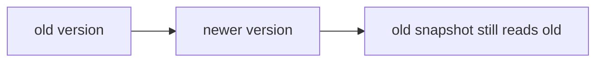

# A04.14 · MVCC

[Phase index](../README.md) · [Core] · 25–40 minutes

Prerequisite [A04.13](A04.13.md) · Next [A04.15](A04.15.md)

## 1. The problem & why it exists

Rows appear to accumulate while a long-running report is open. Track transaction age and maintenance lag. Keep idle transactions and long snapshots bounded.

## 2. Visual mental model



```text
01. old version
02. newer version
03. old snapshot still reads old
```

Follow the responsibilities in order. The fixture isolates one mechanism. Check the engine and observation point before attributing the result to an actual deployment.

## 3. Step-by-step mechanism & minimal dry-run

MVCC keeps tuple versions whose visibility a snapshot can determine. Old versions cannot always be reclaimed while active snapshots may need them. VACUUM makes eligible space reusable.

**Trace.** old version → newer version → old snapshot still reads old.

## 4. Formal rigor & quantitative math

If 50 updates/s retain 200 B old versions for 10 s, raw retained payload can reach 100000 B before page overhead.

Predict the worked quantities by hand, then run the [example](../examples/A04.14.py). It uses a small calculation or state model. For arithmetic, retain the units attached to the worked formula.

## 5. Progressive design

| Run | Expected fixture result | Interpretation |
| --- | --- | --- |
| Failure control | `100000` | Which assumption from the opening problem leads to this result? |
| Normal control | `10000` | Track transaction age and maintenance lag. Keep idle transactions and long snapshots bounded. |

When the fixture reports a modeled value, use the lab to check the corresponding engine behavior. Compare work per request, retained bytes, and operational consequences only where the model measures them.

## 6. Safe local lab & controlled failure injection

```sh
uv run python "01-architecture-A01-to-A20/A04-databases-sql-and-storage-engines/examples/A04.14.py"
uv run python "01-architecture-A01-to-A20/A04-databases-sql-and-storage-engines/examples/A04.14.py" --break
```

Predict both results and identify which input or branch changes. Rerun the normal control as a repair. In a scratch copy, change one key, bound or assumption and predict the result again. Remove the scratch copy after recording your evidence. Apply this reasoning in [L2](../labs/L2.md).

## 7. Production & multi-cloud bridge

Track transaction age and maintenance lag. Keep idle transactions and long snapshots bounded. For deployments on AWS, Azure or Google Cloud, confirm engine version, responsibility for maintenance and which metrics the service exposes. Run production comparisons with the same query mix and recovery objective.

<details>
<summary>Principal question and answer</summary>

What evidence would distinguish the opening failure from a storage-capacity problem? Start with the first divergent boundary in the trace and name the exact mechanism. MVCC keeps tuple versions whose visibility a snapshot can determine. Old versions cannot always be reclaimed while active snapshots may need them. VACUUM makes eligible space reusable.

</details>

## 8. Memory hook & mastery checkpoint

1. Name the operation at the first stage in the trace.
2. Explain the normal and broken outputs before running them.
3. Change one input and compute the revised result with units.
4. How would you test this boundary at deployment scale?
5. What is one assumption that limits the fixture?

<details>
<summary>Check your reasoning</summary>

1. old version.
2. Normal `10000`. Failure `100000`.
3. Reapply the relationship in section 4 to your changed inputs.
4. Track transaction age and maintenance lag. Keep idle transactions and long snapshots bounded.
5. The example uses a small calculation or state model. Check the primary reference for behavior outside that scope.

</details>

## Standards and implementation notes

- [Primary reference](https://www.postgresql.org/docs/current/mvcc-intro.html)
