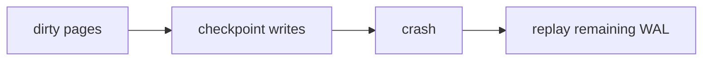

# A04.16 · checkpoints and crash recovery

[Phase index](../README.md) · [Core] · 25–40 minutes

Prerequisite [A04.15](A04.15.md) · Next [A04.17](A04.17.md)

## 1. The problem & why it exists

A restart takes longer after checkpoint configuration changes. Measure replay and checkpoint impact together; keep a tested recovery budget.

## 2. Visual mental model



```text
01. dirty pages
02. checkpoint writes
03. crash
04. replay remaining WAL
```

Follow the responsibilities in order. The fixture isolates one mechanism. Check the engine and observation point before attributing the result to an actual deployment.

## 3. Step-by-step mechanism & minimal dry-run

A checkpoint makes enough dirty state durable to establish a restart point. Crash recovery starts from the required WAL location. Frequent checkpoints can add write traffic and full-page images.

**Trace.** dirty pages → checkpoint writes → crash → replay remaining WAL.

## 4. Formal rigor & quantitative math

At replay throughput 100 MiB/s, 2 GiB of log takes about 20.48 s in a simple throughput model.

Predict the worked quantities by hand, then run the [example](../examples/A04.16.py). It uses a small calculation or state model. For arithmetic, retain the units attached to the worked formula.

## 5. Progressive design

| Run | Expected fixture result | Interpretation |
| --- | --- | --- |
| Failure control | `40.96` | Which assumption from the opening problem leads to this result? |
| Normal control | `20.48` | Measure replay and checkpoint impact together; keep a tested recovery budget. |

When the fixture reports a modeled value, use the lab to check the corresponding engine behavior. Compare work per request, retained bytes, and operational consequences only where the model measures them.

## 6. Safe local lab & controlled failure injection

```sh
uv run python "01-architecture-A01-to-A20/A04-databases-sql-and-storage-engines/examples/A04.16.py"
uv run python "01-architecture-A01-to-A20/A04-databases-sql-and-storage-engines/examples/A04.16.py" --break
```

Predict both results and identify which input or branch changes. Rerun the normal control as a repair. In a scratch copy, change one key, bound or assumption and predict the result again. Remove the scratch copy after recording your evidence. Apply this reasoning in [L3](../labs/L3.md).

## 7. Production & multi-cloud bridge

Measure replay and checkpoint impact together; keep a tested recovery budget. For deployments on AWS, Azure or Google Cloud, confirm engine version, responsibility for maintenance and which metrics the service exposes. Run production comparisons with the same query mix and recovery objective.

<details>
<summary>Principal question and answer</summary>

What evidence would distinguish the opening failure from a storage-capacity problem? Start with the first divergent boundary in the trace and name the exact mechanism. A checkpoint makes enough dirty state durable to establish a restart point. Crash recovery starts from the required WAL location. Frequent checkpoints can add write traffic and full-page images.

</details>

## 8. Memory hook & mastery checkpoint

1. Name the operation at the first stage in the trace.
2. Explain the normal and broken outputs before running them.
3. Change one input and compute the revised result with units.
4. How would you test this boundary at deployment scale?
5. What is one assumption that limits the fixture?

<details>
<summary>Check your reasoning</summary>

1. dirty pages.
2. Normal `20.48`. Failure `40.96`.
3. Reapply the relationship in section 4 to your changed inputs.
4. Measure replay and checkpoint impact together; keep a tested recovery budget.
5. The example uses a small calculation or state model. Check the primary reference for behavior outside that scope.

</details>

## Standards and implementation notes

- [Primary reference](https://www.postgresql.org/docs/current/wal-configuration.html)
