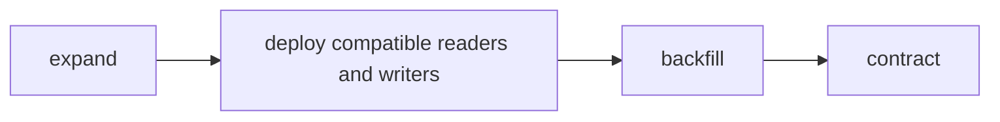

# A04.18 · schema migration and online indexing

[Phase index](../README.md) · [Core] · 25–40 minutes

Prerequisite [A04.17](A04.17.md) · Next [A04.19](A04.19.md)

## 1. The problem & why it exists

A migration waits behind readers and blocks queued requests. Set session-level lock timeouts and rehearse recovery. Inspect invalid indexes before retrying.

## 2. Visual mental model



```text
01. expand
02. deploy compatible readers and writers
03. backfill
04. contract
```

Follow the responsibilities in order. The fixture isolates one mechanism. Check the engine and observation point before attributing the result to an actual deployment.

## 3. Step-by-step mechanism & minimal dry-run

DDL has lock requirements that vary by operation. CREATE INDEX CONCURRENTLY allows ordinary writes but takes additional scans and waits, cannot run inside a normal transaction block, and can leave an invalid index after failure.

**Trace.** expand → deploy compatible readers and writers → backfill → contract.

## 4. Formal rigor & quantitative math

Batching 12000 rows into chunks of 500 uses 24 transactions, trading commit overhead for shorter individual lock lifetimes.

Predict the worked quantities by hand, then run the [example](../examples/A04.18.py). It uses a small calculation or state model. For arithmetic, retain the units attached to the worked formula.

## 5. Progressive design

| Run | Expected fixture result | Interpretation |
| --- | --- | --- |
| Failure control | `12000` | Which assumption from the opening problem leads to this result? |
| Normal control | `24` | Set session-level lock timeouts and rehearse recovery. Inspect invalid indexes before retrying. |

When the fixture reports a modeled value, use the lab to check the corresponding engine behavior. Compare work per request, retained bytes, and operational consequences only where the model measures them.

## 6. Safe local lab & controlled failure injection

```sh
uv run python "01-architecture-A01-to-A20/A04-databases-sql-and-storage-engines/examples/A04.18.py"
uv run python "01-architecture-A01-to-A20/A04-databases-sql-and-storage-engines/examples/A04.18.py" --break
```

Predict both results and identify which input or branch changes. Rerun the normal control as a repair. In a scratch copy, change one key, bound or assumption and predict the result again. Remove the scratch copy after recording your evidence. Apply this reasoning in [L4](../labs/L4.md).

## 7. Production & multi-cloud bridge

Set session-level lock timeouts and rehearse recovery. Inspect invalid indexes before retrying. For deployments on AWS, Azure or Google Cloud, confirm engine version, responsibility for maintenance and which metrics the service exposes. Run production comparisons with the same query mix and recovery objective.

<details>
<summary>Principal question and answer</summary>

What evidence would distinguish the opening failure from a storage-capacity problem? Start with the first divergent boundary in the trace and name the exact mechanism. DDL has lock requirements that vary by operation. CREATE INDEX CONCURRENTLY allows ordinary writes but takes additional scans and waits, cannot run inside a normal transaction block, and can leave an invalid index after failure.

</details>

## 8. Memory hook & mastery checkpoint

1. Name the operation at the first stage in the trace.
2. Explain the normal and broken outputs before running them.
3. Change one input and compute the revised result with units.
4. How would you test this boundary at deployment scale?
5. What is one assumption that limits the fixture?

<details>
<summary>Check your reasoning</summary>

1. expand.
2. Normal `24`. Failure `12000`.
3. Reapply the relationship in section 4 to your changed inputs.
4. Set session-level lock timeouts and rehearse recovery. Inspect invalid indexes before retrying.
5. The example uses a small calculation or state model. Check the primary reference for behavior outside that scope.

</details>

## Standards and implementation notes

- [Primary reference](https://www.postgresql.org/docs/current/sql-createindex.html)
