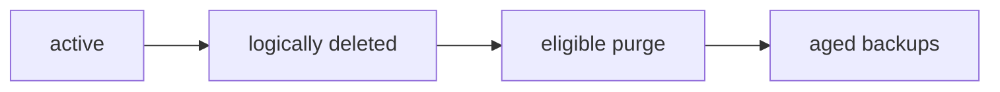

# A04.20 · soft deletion and retention

[Phase index](../README.md) · [Core] · 25–40 minutes

Prerequisite [A04.19](A04.19.md) · Next [A04.21](A04.21.md)

## 1. The problem & why it exists

A soft-deleted account is hidden in the UI but still reserves its username. Enforce default visibility at the data boundary and test restore conflicts and purge cadence.

## 2. Visual mental model



```text
01. active
02. logically deleted
03. eligible purge
04. aged backups
```

Follow the responsibilities in order. The fixture isolates one mechanism. Check the engine and observation point before attributing the result to an actual deployment.

## 3. Step-by-step mechanism & minimal dry-run

Soft deletion changes visibility with a tombstone or timestamp. A partial unique index can enforce active-only uniqueness. Physical retention and restore semantics require separate policies.

**Trace.** active → logically deleted → eligible purge → aged backups.

## 4. Formal rigor & quantitative math

At 20 tombstones/day with 30-day steady retention, about 600 tombstones remain before purge delays.

Predict the worked quantities by hand, then run the [example](../examples/A04.20.py). It uses a small calculation or state model. For arithmetic, retain the units attached to the worked formula.

## 5. Progressive design

| Run | Expected fixture result | Interpretation |
| --- | --- | --- |
| Failure control | `1800` | Which assumption from the opening problem leads to this result? |
| Normal control | `600` | Enforce default visibility at the data boundary and test restore conflicts and purge cadence. |

When the fixture reports a modeled value, use the lab to check the corresponding engine behavior. Compare work per request, retained bytes, and operational consequences only where the model measures them.

## 6. Safe local lab & controlled failure injection

```sh
uv run python "01-architecture-A01-to-A20/A04-databases-sql-and-storage-engines/examples/A04.20.py"
uv run python "01-architecture-A01-to-A20/A04-databases-sql-and-storage-engines/examples/A04.20.py" --break
```

Predict both results and identify which input or branch changes. Rerun the normal control as a repair. In a scratch copy, change one key, bound or assumption and predict the result again. Remove the scratch copy after recording your evidence. Apply this reasoning in [L4](../labs/L4.md).

## 7. Production & multi-cloud bridge

Enforce default visibility at the data boundary and test restore conflicts and purge cadence. For deployments on AWS, Azure or Google Cloud, confirm engine version, responsibility for maintenance and which metrics the service exposes. Run production comparisons with the same query mix and recovery objective.

<details>
<summary>Principal question and answer</summary>

What evidence would distinguish the opening failure from a storage-capacity problem? Start with the first divergent boundary in the trace and name the exact mechanism. Soft deletion changes visibility with a tombstone or timestamp. A partial unique index can enforce active-only uniqueness. Physical retention and restore semantics require separate policies.

</details>

## 8. Memory hook & mastery checkpoint

1. Name the operation at the first stage in the trace.
2. Explain the normal and broken outputs before running them.
3. Change one input and compute the revised result with units.
4. How would you test this boundary at deployment scale?
5. What is one assumption that limits the fixture?

<details>
<summary>Check your reasoning</summary>

1. active.
2. Normal `600`. Failure `1800`.
3. Reapply the relationship in section 4 to your changed inputs.
4. Enforce default visibility at the data boundary and test restore conflicts and purge cadence.
5. The example uses a small calculation or state model. Check the primary reference for behavior outside that scope.

</details>

## Standards and implementation notes

- [Primary reference](https://www.postgresql.org/docs/current/indexes-partial.html)
