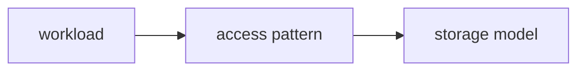

# A04.21 · document vs key-value vs graph vs columnar stores

[Phase index](../README.md) · [Core] · 25–40 minutes

Prerequisite [A04.20](A04.20.md) · Next [A04.22](A04.22.md)

## 1. The problem & why it exists

A graph traversal is implemented as N remote key lookups per hop. Choose based on measured operations, consistency and operational cost.

## 2. Visual mental model



```text
01. workload
02. access pattern
03. storage model
```

Follow the responsibilities in order. The fixture isolates one mechanism. Check the engine and observation point before attributing the result to an actual deployment.

## 3. Step-by-step mechanism & minimal dry-run

Key-value stores optimize keyed access, document stores represent aggregate structures, graph systems emphasize relationships, and columnar layouts reduce reads of irrelevant columns for scans. Product capabilities overlap.

**Trace.** workload → access pattern → storage model.

## 4. Formal rigor & quantitative math

A projection of 2 equal-width columns out of 20 reads roughly 10% of column payload under ideal pruning; metadata and compression change actual I/O.

Predict the worked quantities by hand, then run the [example](../examples/A04.21.py). It uses a small calculation or state model. For arithmetic, retain the units attached to the worked formula.

## 5. Progressive design

| Run | Expected fixture result | Interpretation |
| --- | --- | --- |
| Failure control | `1.0` | Which assumption from the opening problem leads to this result? |
| Normal control | `0.1` | Choose based on measured operations, consistency and operational cost. |

When the fixture reports a modeled value, use the lab to check the corresponding engine behavior. Compare work per request, retained bytes, and operational consequences only where the model measures them.

## 6. Safe local lab & controlled failure injection

```sh
uv run python "01-architecture-A01-to-A20/A04-databases-sql-and-storage-engines/examples/A04.21.py"
uv run python "01-architecture-A01-to-A20/A04-databases-sql-and-storage-engines/examples/A04.21.py" --break
```

Predict both results and identify which input or branch changes. Rerun the normal control as a repair. In a scratch copy, change one key, bound or assumption and predict the result again. Remove the scratch copy after recording your evidence. Apply this reasoning in [L1](../labs/L1.md).

## 7. Production & multi-cloud bridge

Choose based on measured operations, consistency and operational cost. For deployments on AWS, Azure or Google Cloud, confirm engine version, responsibility for maintenance and which metrics the service exposes. Run production comparisons with the same query mix and recovery objective.

<details>
<summary>Principal question and answer</summary>

What evidence would distinguish the opening failure from a storage-capacity problem? Start with the first divergent boundary in the trace and name the exact mechanism. Key-value stores optimize keyed access, document stores represent aggregate structures, graph systems emphasize relationships, and columnar layouts reduce reads of irrelevant columns for scans. Product capabilities overlap.

</details>

## 8. Memory hook & mastery checkpoint

1. Name the operation at the first stage in the trace.
2. Explain the normal and broken outputs before running them.
3. Change one input and compute the revised result with units.
4. How would you test this boundary at deployment scale?
5. What is one assumption that limits the fixture?

<details>
<summary>Check your reasoning</summary>

1. workload.
2. Normal `0.1`. Failure `1.0`.
3. Reapply the relationship in section 4 to your changed inputs.
4. Choose based on measured operations, consistency and operational cost.
5. The example uses a small calculation or state model. Check the primary reference for behavior outside that scope.

</details>

## Standards and implementation notes

- [Primary reference](https://www.postgresql.org/docs/current/tableam.html)
