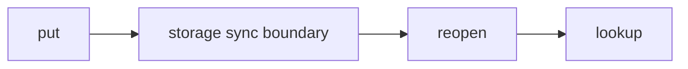

# A04.23 · file-backed dictionaries

[Phase index](../README.md) · [Principal] · 25–40 minutes

Prerequisite [A04.22](A04.22.md) · Next [A04.24](A04.24.md)

## 1. The problem & why it exists

A dictionary disappears when the process exits. Prefer a mature storage layer for concurrent updates and recovery.

## 2. Visual mental model



```text
01. put
02. storage sync boundary
03. reopen
04. lookup
```

Follow the responsibilities in order. The fixture isolates one mechanism. Check the engine and observation point before attributing the result to an actual deployment.

## 3. Step-by-step mechanism & minimal dry-run

Persistent key-value data needs a documented binary format or maintained database. A file-backed mapping separates API lookup from processes' transient memory. Atomic update and multi-writer policy are part of the contract.

**Trace.** put → storage sync boundary → reopen → lookup.

## 4. Formal rigor & quantitative math

For 42 keys with 64 B values, payload alone is 2688 B; allocation and index overhead are additional.

Predict the worked quantities by hand, then run the [example](../examples/A04.23.py). It uses an actual local dbm file. For arithmetic, retain the units attached to the worked formula.

## 5. Progressive design

| Run | Expected fixture result | Interpretation |
| --- | --- | --- |
| Failure control | `None` | Which assumption from the opening problem leads to this result? |
| Normal control | `'durable'` | Prefer a mature storage layer for concurrent updates and recovery. |

When the fixture reports a modeled value, use the lab to check the corresponding engine behavior. Compare work per request, retained bytes, and operational consequences only where the model measures them.

## 6. Safe local lab & controlled failure injection

```sh
uv run python "01-architecture-A01-to-A20/A04-databases-sql-and-storage-engines/examples/A04.23.py"
uv run python "01-architecture-A01-to-A20/A04-databases-sql-and-storage-engines/examples/A04.23.py" --break
```

Predict both results and identify which input or branch changes. Rerun the normal control as a repair. In a scratch copy, change one key, bound or assumption and predict the result again. Remove the scratch copy after recording your evidence. Apply this reasoning in [L3](../labs/L3.md).

## 7. Production & multi-cloud bridge

Prefer a mature storage layer for concurrent updates and recovery. For deployments on AWS, Azure or Google Cloud, confirm engine version, responsibility for maintenance and which metrics the service exposes. Run production comparisons with the same query mix and recovery objective.

<details>
<summary>Principal question and answer</summary>

What evidence would distinguish the opening failure from a storage-capacity problem? Start with the first divergent boundary in the trace and name the exact mechanism. Persistent key-value data needs a documented binary format or maintained database. A file-backed mapping separates API lookup from processes' transient memory. Atomic update and multi-writer policy are part of the contract.

</details>

## 8. Memory hook & mastery checkpoint

1. Name the operation at the first stage in the trace.
2. Explain the normal and broken outputs before running them.
3. Change one input and compute the revised result with units.
4. How would you test this boundary at deployment scale?
5. What is one assumption that limits the fixture?

<details>
<summary>Check your reasoning</summary>

1. put.
2. Normal `'durable'`. Failure `None`.
3. Reapply the relationship in section 4 to your changed inputs.
4. Prefer a mature storage layer for concurrent updates and recovery.
5. The example uses an actual local dbm file. Check the primary reference for behavior outside that scope.

</details>

## Standards and implementation notes

- [Primary reference](https://docs.python.org/3/library/dbm.html)
