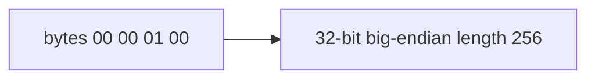

# A04.24 · binary encodings

[Phase index](../README.md) · [Principal] · 25–40 minutes

Prerequisite [A04.23](A04.23.md) · Next [A04.25](A04.25.md)

## 1. The problem & why it exists

A reader interprets a stored record length in the wrong endian order. Specify endian order and version explicitly. Reserve room for schema evolution.

## 2. Visual mental model



```text
01. bytes 00 00 01 00
02. 32-bit big-endian length 256
```

Follow the responsibilities in order. The fixture isolates one mechanism. Check the engine and observation point before attributing the result to an actual deployment.

## 3. Step-by-step mechanism & minimal dry-run

A binary format defines field widths, byte order, framing and what counts as invalid. Read a complete length prefix, validate a bound, and handle incomplete trailing data.

**Trace.** bytes 00 00 01 00 → 32-bit big-endian length 256.

## 4. Formal rigor & quantitative math

For b=4 unsigned length bytes there are 2^(8b) distinct encodings. A safe application caps actual sizes far below that theoretical range.

Predict the worked quantities by hand, then run the [example](../examples/A04.24.py). It uses binary encoding or checksum code. For arithmetic, retain the units attached to the worked formula.

## 5. Progressive design

| Run | Expected fixture result | Interpretation |
| --- | --- | --- |
| Failure control | `65536` | Which assumption from the opening problem leads to this result? |
| Normal control | `256` | Specify endian order and version explicitly. Reserve room for schema evolution. |

When the fixture reports a modeled value, use the lab to check the corresponding engine behavior. Compare work per request, retained bytes, and operational consequences only where the model measures them.

## 6. Safe local lab & controlled failure injection

```sh
uv run python "01-architecture-A01-to-A20/A04-databases-sql-and-storage-engines/examples/A04.24.py"
uv run python "01-architecture-A01-to-A20/A04-databases-sql-and-storage-engines/examples/A04.24.py" --break
```

Predict both results and identify which input or branch changes. Rerun the normal control as a repair. In a scratch copy, change one key, bound or assumption and predict the result again. Remove the scratch copy after recording your evidence. Apply this reasoning in [L3](../labs/L3.md).

## 7. Production & multi-cloud bridge

Specify endian order and version explicitly. Reserve room for schema evolution. For deployments on AWS, Azure or Google Cloud, confirm engine version, responsibility for maintenance and which metrics the service exposes. Run production comparisons with the same query mix and recovery objective.

<details>
<summary>Principal question and answer</summary>

What evidence would distinguish the opening failure from a storage-capacity problem? Start with the first divergent boundary in the trace and name the exact mechanism. A binary format defines field widths, byte order, framing and what counts as invalid. Read a complete length prefix, validate a bound, and handle incomplete trailing data.

</details>

## 8. Memory hook & mastery checkpoint

1. Name the operation at the first stage in the trace.
2. Explain the normal and broken outputs before running them.
3. Change one input and compute the revised result with units.
4. How would you test this boundary at deployment scale?
5. What is one assumption that limits the fixture?

<details>
<summary>Check your reasoning</summary>

1. bytes 00 00 01 00.
2. Normal `256`. Failure `65536`.
3. Reapply the relationship in section 4 to your changed inputs.
4. Specify endian order and version explicitly. Reserve room for schema evolution.
5. The example uses binary encoding or checksum code. Check the primary reference for behavior outside that scope.

</details>

## Standards and implementation notes

- [Primary reference](https://docs.python.org/3/library/struct.html)
