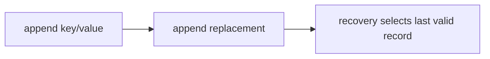

# A04.25 · append-only and log-structured storage

[Phase index](../README.md) · [Principal] · 25–40 minutes

Prerequisite [A04.24](A04.24.md) · Next [A04.26](A04.26.md)

## 1. The problem & why it exists

Overwriting a file record destroys the last good version on a partial failure. Use framing and checksums; preserve a valid old segment until a rewritten generation is committed.

## 2. Visual mental model



```text
01. append key/value
02. append replacement
03. recovery selects last valid record
```

Follow the responsibilities in order. The fixture isolates one mechanism. Check the engine and observation point before attributing the result to an actual deployment.

## 3. Step-by-step mechanism & minimal dry-run

Append-only updates preserve previous records. Recovery scans complete valid records and reconstructs the latest state. Space reclamation and safe tail recovery need explicit rules.

**Trace.** append key/value → append replacement → recovery selects last valid record.

## 4. Formal rigor & quantitative math

At 5 versions of 100 B per key, raw data is 500 B before compaction and 100 B of current payload.

Predict the worked quantities by hand, then run the [example](../examples/A04.25.py). It uses a small calculation or state model. For arithmetic, retain the units attached to the worked formula.

## 5. Progressive design

| Run | Expected fixture result | Interpretation |
| --- | --- | --- |
| Failure control | `500` | Which assumption from the opening problem leads to this result? |
| Normal control | `100` | Use framing and checksums; preserve a valid old segment until a rewritten generation is committed. |

When the fixture reports a modeled value, use the lab to check the corresponding engine behavior. Compare work per request, retained bytes, and operational consequences only where the model measures them.

## 6. Safe local lab & controlled failure injection

```sh
uv run python "01-architecture-A01-to-A20/A04-databases-sql-and-storage-engines/examples/A04.25.py"
uv run python "01-architecture-A01-to-A20/A04-databases-sql-and-storage-engines/examples/A04.25.py" --break
```

Predict both results and identify which input or branch changes. Rerun the normal control as a repair. In a scratch copy, change one key, bound or assumption and predict the result again. Remove the scratch copy after recording your evidence. Apply this reasoning in [L3](../labs/L3.md).

## 7. Production & multi-cloud bridge

Use framing and checksums; preserve a valid old segment until a rewritten generation is committed. For deployments on AWS, Azure or Google Cloud, confirm engine version, responsibility for maintenance and which metrics the service exposes. Run production comparisons with the same query mix and recovery objective.

<details>
<summary>Principal question and answer</summary>

What evidence would distinguish the opening failure from a storage-capacity problem? Start with the first divergent boundary in the trace and name the exact mechanism. Append-only updates preserve previous records. Recovery scans complete valid records and reconstructs the latest state. Space reclamation and safe tail recovery need explicit rules.

</details>

## 8. Memory hook & mastery checkpoint

1. Name the operation at the first stage in the trace.
2. Explain the normal and broken outputs before running them.
3. Change one input and compute the revised result with units.
4. How would you test this boundary at deployment scale?
5. What is one assumption that limits the fixture?

<details>
<summary>Check your reasoning</summary>

1. append key/value.
2. Normal `100`. Failure `500`.
3. Reapply the relationship in section 4 to your changed inputs.
4. Use framing and checksums; preserve a valid old segment until a rewritten generation is committed.
5. The example uses a small calculation or state model. Check the primary reference for behavior outside that scope.

</details>

## Standards and implementation notes

- [Primary reference](https://www.postgresql.org/docs/current/wal-intro.html)
