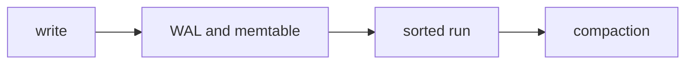

# A04.27 · LSM memtable/WAL/SSTable

[Phase index](../README.md) · [Principal] · 25–40 minutes

Prerequisite [A04.26](A04.26.md) · Next [A04.28](A04.28.md)

## 1. The problem & why it exists

An acknowledged update lives only in volatile sorted memory. Track read, write and space amplification. Use tested storage tooling for durable flush ordering.

## 2. Visual mental model



```text
01. write
02. WAL and memtable
03. sorted run
04. compaction
```

Follow the responsibilities in order. The fixture isolates one mechanism. Check the engine and observation point before attributing the result to an actual deployment.

## 3. Step-by-step mechanism & minimal dry-run

An LSM write typically appends WAL and updates a memtable, then flushes immutable sorted files. Recovery replays required WAL; reads reconcile newer versions and tombstones across levels.

**Trace.** write → WAL and memtable → sorted run → compaction.

## 4. Formal rigor & quantitative math

Writing 60 MiB of values with 20 MiB memtables requires at least three flush-sized batches in the idealized model.

Predict the worked quantities by hand, then run the [example](../examples/A04.27.py). It uses a small calculation or state model. For arithmetic, retain the units attached to the worked formula.

## 5. Progressive design

| Run | Expected fixture result | Interpretation |
| --- | --- | --- |
| Failure control | `4` | Which assumption from the opening problem leads to this result? |
| Normal control | `9` | Track read, write and space amplification. Use tested storage tooling for durable flush ordering. |

When the fixture reports a modeled value, use the lab to check the corresponding engine behavior. Compare work per request, retained bytes, and operational consequences only where the model measures them.

## 6. Safe local lab & controlled failure injection

```sh
uv run python "01-architecture-A01-to-A20/A04-databases-sql-and-storage-engines/examples/A04.27.py"
uv run python "01-architecture-A01-to-A20/A04-databases-sql-and-storage-engines/examples/A04.27.py" --break
```

Predict both results and identify which input or branch changes. Rerun the normal control as a repair. In a scratch copy, change one key, bound or assumption and predict the result again. Remove the scratch copy after recording your evidence. Apply this reasoning in [L3](../labs/L3.md).

## 7. Production & multi-cloud bridge

Track read, write and space amplification. Use tested storage tooling for durable flush ordering. For deployments on AWS, Azure or Google Cloud, confirm engine version, responsibility for maintenance and which metrics the service exposes. Run production comparisons with the same query mix and recovery objective.

<details>
<summary>Principal question and answer</summary>

What evidence would distinguish the opening failure from a storage-capacity problem? Start with the first divergent boundary in the trace and name the exact mechanism. An LSM write typically appends WAL and updates a memtable, then flushes immutable sorted files. Recovery replays required WAL; reads reconcile newer versions and tombstones across levels.

</details>

## 8. Memory hook & mastery checkpoint

1. Name the operation at the first stage in the trace.
2. Explain the normal and broken outputs before running them.
3. Change one input and compute the revised result with units.
4. How would you test this boundary at deployment scale?
5. What is one assumption that limits the fixture?

<details>
<summary>Check your reasoning</summary>

1. write.
2. Normal `9`. Failure `4`.
3. Reapply the relationship in section 4 to your changed inputs.
4. Track read, write and space amplification. Use tested storage tooling for durable flush ordering.
5. The example uses a small calculation or state model. Check the primary reference for behavior outside that scope.

</details>

## Standards and implementation notes

- [Primary reference](https://github.com/facebook/rocksdb/wiki/RocksDB-Overview)
