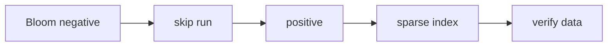

# A04.28 · Bloom/sparse indexes

[Phase index](../README.md) · [Principal] · 25–40 minutes

Prerequisite [A04.27](A04.27.md) · Next [A04.29](A04.29.md)

## 1. The problem & why it exists

Reading a missing key touches every sorted run. Never treat a positive as proof of existence. Estimate memory and measure false positives with actual keys.

## 2. Visual mental model



```text
01. Bloom negative
02. skip run
03. positive
04. sparse index
05. verify data
```

Follow the responsibilities in order. The fixture isolates one mechanism. Check the engine and observation point before attributing the result to an actual deployment.

## 3. Step-by-step mechanism & minimal dry-run

A Bloom filter can prove absence and can report false positives. Sparse indexes narrow a sorted search interval by recording selected keys and offsets.

**Trace.** Bloom negative → skip run; positive → sparse index → verify data.

## 4. Formal rigor & quantitative math

If 10 runs each have 1% false-positive probability for an absent key, expected unnecessary probes are 0.1 by linearity.

Predict the worked quantities by hand, then run the [example](../examples/A04.28.py). It uses a small calculation or state model. For arithmetic, retain the units attached to the worked formula.

## 5. Progressive design

| Run | Expected fixture result | Interpretation |
| --- | --- | --- |
| Failure control | `10.0` | Which assumption from the opening problem leads to this result? |
| Normal control | `0.1` | Never treat a positive as proof of existence. Estimate memory and measure false positives with actual keys. |

When the fixture reports a modeled value, use the lab to check the corresponding engine behavior. Compare work per request, retained bytes, and operational consequences only where the model measures them.

## 6. Safe local lab & controlled failure injection

```sh
uv run python "01-architecture-A01-to-A20/A04-databases-sql-and-storage-engines/examples/A04.28.py"
uv run python "01-architecture-A01-to-A20/A04-databases-sql-and-storage-engines/examples/A04.28.py" --break
```

Predict both results and identify which input or branch changes. Rerun the normal control as a repair. In a scratch copy, change one key, bound or assumption and predict the result again. Remove the scratch copy after recording your evidence. Apply this reasoning in [L3](../labs/L3.md).

## 7. Production & multi-cloud bridge

Never treat a positive as proof of existence. Estimate memory and measure false positives with actual keys. For deployments on AWS, Azure or Google Cloud, confirm engine version, responsibility for maintenance and which metrics the service exposes. Run production comparisons with the same query mix and recovery objective.

<details>
<summary>Principal question and answer</summary>

What evidence would distinguish the opening failure from a storage-capacity problem? Start with the first divergent boundary in the trace and name the exact mechanism. A Bloom filter can prove absence and can report false positives. Sparse indexes narrow a sorted search interval by recording selected keys and offsets.

</details>

## 8. Memory hook & mastery checkpoint

1. Name the operation at the first stage in the trace.
2. Explain the normal and broken outputs before running them.
3. Change one input and compute the revised result with units.
4. How would you test this boundary at deployment scale?
5. What is one assumption that limits the fixture?

<details>
<summary>Check your reasoning</summary>

1. Bloom negative.
2. Normal `0.1`. Failure `10.0`.
3. Reapply the relationship in section 4 to your changed inputs.
4. Never treat a positive as proof of existence. Estimate memory and measure false positives with actual keys.
5. The example uses a small calculation or state model. Check the primary reference for behavior outside that scope.

</details>

## Standards and implementation notes

- [Primary reference](https://github.com/facebook/rocksdb/wiki/RocksDB-Bloom-Filter)
