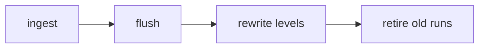

# A04.29 · compaction and write amplification

[Phase index](../README.md) · [Principal] · 25–40 minutes

Prerequisite [A04.28](A04.28.md) · Next [A04.30](A04.30.md)

## 1. The problem & why it exists

A storage device writes much more than the application sends. Track compaction debt and verify whether WAL and device-internal writes are included in the measurement.

## 2. Visual mental model



```text
01. ingest
02. flush
03. rewrite levels
04. retire old runs
```

Follow the responsibilities in order. The fixture isolates one mechanism. Check the engine and observation point before attributing the result to an actual deployment.

## 3. Step-by-step mechanism & minimal dry-run

Compaction rewrites sorted files to merge keys and remove obsolete versions when safe. Tombstones can be dropped only when older data cannot reappear from other levels or replicas.

**Trace.** ingest → flush → rewrite levels → retire old runs.

## 4. Formal rigor & quantitative math

If 100 MiB user writes cause 350 MiB device writes in one defined accounting scope, write amplification is 3.5×.

Predict the worked quantities by hand, then run the [example](../examples/A04.29.py). It uses a small calculation or state model. For arithmetic, retain the units attached to the worked formula.

## 5. Progressive design

| Run | Expected fixture result | Interpretation |
| --- | --- | --- |
| Failure control | `1.0` | Which assumption from the opening problem leads to this result? |
| Normal control | `3.5` | Track compaction debt and verify whether WAL and device-internal writes are included in the measurement. |

When the fixture reports a modeled value, use the lab to check the corresponding engine behavior. Compare work per request, retained bytes, and operational consequences only where the model measures them.

## 6. Safe local lab & controlled failure injection

```sh
uv run python "01-architecture-A01-to-A20/A04-databases-sql-and-storage-engines/examples/A04.29.py"
uv run python "01-architecture-A01-to-A20/A04-databases-sql-and-storage-engines/examples/A04.29.py" --break
```

Predict both results and identify which input or branch changes. Rerun the normal control as a repair. In a scratch copy, change one key, bound or assumption and predict the result again. Remove the scratch copy after recording your evidence. Apply this reasoning in [L3](../labs/L3.md).

## 7. Production & multi-cloud bridge

Track compaction debt and verify whether WAL and device-internal writes are included in the measurement. For deployments on AWS, Azure or Google Cloud, confirm engine version, responsibility for maintenance and which metrics the service exposes. Run production comparisons with the same query mix and recovery objective.

<details>
<summary>Principal question and answer</summary>

What evidence would distinguish the opening failure from a storage-capacity problem? Start with the first divergent boundary in the trace and name the exact mechanism. Compaction rewrites sorted files to merge keys and remove obsolete versions when safe. Tombstones can be dropped only when older data cannot reappear from other levels or replicas.

</details>

## 8. Memory hook & mastery checkpoint

1. Name the operation at the first stage in the trace.
2. Explain the normal and broken outputs before running them.
3. Change one input and compute the revised result with units.
4. How would you test this boundary at deployment scale?
5. What is one assumption that limits the fixture?

<details>
<summary>Check your reasoning</summary>

1. ingest.
2. Normal `3.5`. Failure `1.0`.
3. Reapply the relationship in section 4 to your changed inputs.
4. Track compaction debt and verify whether WAL and device-internal writes are included in the measurement.
5. The example uses a small calculation or state model. Check the primary reference for behavior outside that scope.

</details>

## Standards and implementation notes

- [Primary reference](https://github.com/facebook/rocksdb/wiki/Compaction)
