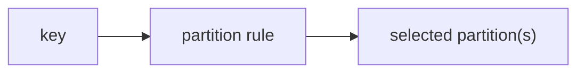

# A04.30 · range and hash partitioning

[Phase index](../README.md) · [Principal] · 25–40 minutes

Prerequisite [A04.29](A04.29.md) · Next [A04.31](A04.31.md)

## 1. The problem & why it exists

A query touches every partition despite having a selective filter. Choose keys based on filters, skew and lifecycle operations. Check actual pruning in execution plans.

## 2. Visual mental model



```text
01. key
02. partition rule
03. selected partition(s)
```

Follow the responsibilities in order. The fixture isolates one mechanism. Check the engine and observation point before attributing the result to an actual deployment.

## 3. Step-by-step mechanism & minimal dry-run

Partition boundaries determine pruning. Range partitions align with ordered predicates, hash partitions spread keys but do not usually prune arbitrary ranges, and a single popular key remains hot.

**Trace.** key → partition rule → selected partition(s).

## 4. Formal rigor & quantitative math

Twelve equal monthly partitions and a two-month range imply about one-sixth of payload eligible for reading under ideal pruning.

Predict the worked quantities by hand, then run the [example](../examples/A04.30.py). It uses a small calculation or state model. For arithmetic, retain the units attached to the worked formula.

## 5. Progressive design

| Run | Expected fixture result | Interpretation |
| --- | --- | --- |
| Failure control | `1.0` | Which assumption from the opening problem leads to this result? |
| Normal control | `0.16666666666666666` | Choose keys based on filters, skew and lifecycle operations. Check actual pruning in execution plans. |

When the fixture reports a modeled value, use the lab to check the corresponding engine behavior. Compare work per request, retained bytes, and operational consequences only where the model measures them.

## 6. Safe local lab & controlled failure injection

```sh
uv run python "01-architecture-A01-to-A20/A04-databases-sql-and-storage-engines/examples/A04.30.py"
uv run python "01-architecture-A01-to-A20/A04-databases-sql-and-storage-engines/examples/A04.30.py" --break
```

Predict both results and identify which input or branch changes. Rerun the normal control as a repair. In a scratch copy, change one key, bound or assumption and predict the result again. Remove the scratch copy after recording your evidence. Apply this reasoning in [L1](../labs/L1.md).

## 7. Production & multi-cloud bridge

Choose keys based on filters, skew and lifecycle operations. Check actual pruning in execution plans. For deployments on AWS, Azure or Google Cloud, confirm engine version, responsibility for maintenance and which metrics the service exposes. Run production comparisons with the same query mix and recovery objective.

<details>
<summary>Principal question and answer</summary>

What evidence would distinguish the opening failure from a storage-capacity problem? Start with the first divergent boundary in the trace and name the exact mechanism. Partition boundaries determine pruning. Range partitions align with ordered predicates, hash partitions spread keys but do not usually prune arbitrary ranges, and a single popular key remains hot.

</details>

## 8. Memory hook & mastery checkpoint

1. Name the operation at the first stage in the trace.
2. Explain the normal and broken outputs before running them.
3. Change one input and compute the revised result with units.
4. How would you test this boundary at deployment scale?
5. What is one assumption that limits the fixture?

<details>
<summary>Check your reasoning</summary>

1. key.
2. Normal `0.16666666666666666`. Failure `1.0`.
3. Reapply the relationship in section 4 to your changed inputs.
4. Choose keys based on filters, skew and lifecycle operations. Check actual pruning in execution plans.
5. The example uses a small calculation or state model. Check the primary reference for behavior outside that scope.

</details>

## Standards and implementation notes

- [Primary reference](https://www.postgresql.org/docs/current/ddl-partitioning.html)
