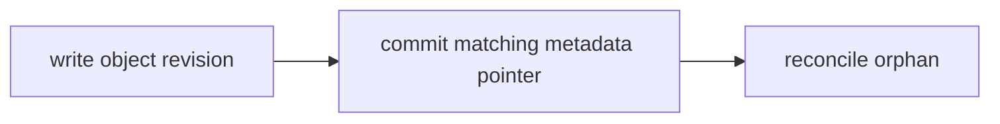

# A04.32 · object store metadata

[Phase index](../README.md) · [Principal] · 25–40 minutes

Prerequisite [A04.31](A04.31.md) · Next [A04.33](A04.33.md)

## 1. The problem & why it exists

An application assumes object metadata and its SQL record update atomically. Use version-aware manifests and reconciliation rather than assuming a distributed transaction.

## 2. Visual mental model



```text
01. write object revision
02. commit matching metadata pointer
03. reconcile orphan
```

Follow the responsibilities in order. The fixture isolates one mechanism. Check the engine and observation point before attributing the result to an actual deployment.

## 3. Step-by-step mechanism & minimal dry-run

An object store handles object keys, data and metadata. Its operation-level consistency depends on the provider and operation, separate from transactional guarantees of a database or external index.

**Trace.** write object revision → commit matching metadata pointer → reconcile orphan.

## 4. Formal rigor & quantitative math

At 200 objects/s and 300 B index metadata per object, metadata ingest is 60000 B/s before index overhead.

Predict the worked quantities by hand, then run the [example](../examples/A04.32.py). It uses a small calculation or state model. For arithmetic, retain the units attached to the worked formula.

## 5. Progressive design

| Run | Expected fixture result | Interpretation |
| --- | --- | --- |
| Failure control | `('v2', 'v1')` | Which assumption from the opening problem leads to this result? |
| Normal control | `('v2', 'v2')` | Use version-aware manifests and reconciliation rather than assuming a distributed transaction. |

When the fixture reports a modeled value, use the lab to check the corresponding engine behavior. Compare work per request, retained bytes, and operational consequences only where the model measures them.

## 6. Safe local lab & controlled failure injection

```sh
uv run python "01-architecture-A01-to-A20/A04-databases-sql-and-storage-engines/examples/A04.32.py"
uv run python "01-architecture-A01-to-A20/A04-databases-sql-and-storage-engines/examples/A04.32.py" --break
```

Predict both results and identify which input or branch changes. Rerun the normal control as a repair. In a scratch copy, change one key, bound or assumption and predict the result again. Remove the scratch copy after recording your evidence. Apply this reasoning in [L4](../labs/L4.md).

## 7. Production & multi-cloud bridge

Use version-aware manifests and reconciliation rather than assuming a distributed transaction. For deployments on AWS, Azure or Google Cloud, confirm engine version, responsibility for maintenance and which metrics the service exposes. Run production comparisons with the same query mix and recovery objective.

<details>
<summary>Principal question and answer</summary>

What evidence would distinguish the opening failure from a storage-capacity problem? Start with the first divergent boundary in the trace and name the exact mechanism. An object store handles object keys, data and metadata. Its operation-level consistency depends on the provider and operation, separate from transactional guarantees of a database or external index.

</details>

## 8. Memory hook & mastery checkpoint

1. Name the operation at the first stage in the trace.
2. Explain the normal and broken outputs before running them.
3. Change one input and compute the revised result with units.
4. How would you test this boundary at deployment scale?
5. What is one assumption that limits the fixture?

<details>
<summary>Check your reasoning</summary>

1. write object revision.
2. Normal `('v2', 'v2')`. Failure `('v2', 'v1')`.
3. Reapply the relationship in section 4 to your changed inputs.
4. Use version-aware manifests and reconciliation rather than assuming a distributed transaction.
5. The example uses a small calculation or state model. Check the primary reference for behavior outside that scope.

</details>

## Standards and implementation notes

- [Primary reference](https://docs.aws.amazon.com/AmazonS3/latest/userguide/Welcome.html)
