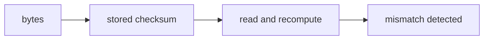

# A04.35 · checksums

[Phase index](../README.md) · [Principal] · 25–40 minutes

Prerequisite [A04.34](A04.34.md) · Next [A04.36](A04.36.md)

## 1. The problem & why it exists

A record parses successfully even after one byte flips. Choose checksum scope and verify during reads and restores. Use authenticated mechanisms for hostile modifications.

## 2. Visual mental model



```text
01. bytes
02. stored checksum
03. read and recompute
04. mismatch detected
```

Follow the responsibilities in order. The fixture isolates one mechanism. Check the engine and observation point before attributing the result to an actual deployment.

## 3. Step-by-step mechanism & minimal dry-run

Checksums detect many accidental corruptions. CRC is not a cryptographic authentication mechanism. Recovery still needs a valid copy of data or redundancy.

**Trace.** bytes → stored checksum → read and recompute → mismatch detected.

## 4. Formal rigor & quantitative math

For a uniformly distributed 32-bit checksum under a random error model, accidental collision probability is about 1/2^32. The error model matters.

Predict the worked quantities by hand, then run the [example](../examples/A04.35.py). It uses binary encoding or checksum code. For arithmetic, retain the units attached to the worked formula.

## 5. Progressive design

| Run | Expected fixture result | Interpretation |
| --- | --- | --- |
| Failure control | `True` | Which assumption from the opening problem leads to this result? |
| Normal control | `False` | Choose checksum scope and verify during reads and restores. Use authenticated mechanisms for hostile modifications. |

When the fixture reports a modeled value, use the lab to check the corresponding engine behavior. Compare work per request, retained bytes, and operational consequences only where the model measures them.

## 6. Safe local lab & controlled failure injection

```sh
uv run python "01-architecture-A01-to-A20/A04-databases-sql-and-storage-engines/examples/A04.35.py"
uv run python "01-architecture-A01-to-A20/A04-databases-sql-and-storage-engines/examples/A04.35.py" --break
```

Predict both results and identify which input or branch changes. Rerun the normal control as a repair. In a scratch copy, change one key, bound or assumption and predict the result again. Remove the scratch copy after recording your evidence. Apply this reasoning in [L3](../labs/L3.md).

## 7. Production & multi-cloud bridge

Choose checksum scope and verify during reads and restores. Use authenticated mechanisms for hostile modifications. For deployments on AWS, Azure or Google Cloud, confirm engine version, responsibility for maintenance and which metrics the service exposes. Run production comparisons with the same query mix and recovery objective.

<details>
<summary>Principal question and answer</summary>

What evidence would distinguish the opening failure from a storage-capacity problem? Start with the first divergent boundary in the trace and name the exact mechanism. Checksums detect many accidental corruptions. CRC is not a cryptographic authentication mechanism. Recovery still needs a valid copy of data or redundancy.

</details>

## 8. Memory hook & mastery checkpoint

1. Name the operation at the first stage in the trace.
2. Explain the normal and broken outputs before running them.
3. Change one input and compute the revised result with units.
4. How would you test this boundary at deployment scale?
5. What is one assumption that limits the fixture?

<details>
<summary>Check your reasoning</summary>

1. bytes.
2. Normal `False`. Failure `True`.
3. Reapply the relationship in section 4 to your changed inputs.
4. Choose checksum scope and verify during reads and restores. Use authenticated mechanisms for hostile modifications.
5. The example uses binary encoding or checksum code. Check the primary reference for behavior outside that scope.

</details>

## Standards and implementation notes

- [Primary reference](https://www.postgresql.org/docs/current/app-pgchecksums.html)
