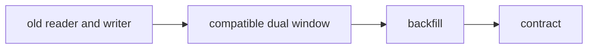

# A04.36 · online evolution

[Phase index](../README.md) · [Principal] · 25–40 minutes

Prerequisite [A04.35](A04.35.md) · Next [A04.37](A04.37.md)

## 1. The problem & why it exists

Deploying a new writer breaks older readers during a rolling update. Make progress observable and repeatable. Test old and new readers during every rollout phase.

## 2. Visual mental model



```text
01. old reader and writer
02. compatible dual window
03. backfill
04. contract
```

Follow the responsibilities in order. The fixture isolates one mechanism. Check the engine and observation point before attributing the result to an actual deployment.

## 3. Step-by-step mechanism & minimal dry-run

Expand-contract evolves schemas in compatible steps. Introduce optional fields, backfill, switch reads with evidence, then remove the old contract after rollback and retention constraints allow.

**Trace.** old reader and writer → compatible dual window → backfill → contract.

## 4. Formal rigor & quantitative math

A 10000-row backfill at 500 rows/s needs at least 20 s ignoring locks and retries.

Predict the worked quantities by hand, then run the [example](../examples/A04.36.py). It uses a small calculation or state model. For arithmetic, retain the units attached to the worked formula.

## 5. Progressive design

| Run | Expected fixture result | Interpretation |
| --- | --- | --- |
| Failure control | `None` | Which assumption from the opening problem leads to this result? |
| Normal control | `5` | Make progress observable and repeatable. Test old and new readers during every rollout phase. |

When the fixture reports a modeled value, use the lab to check the corresponding engine behavior. Compare work per request, retained bytes, and operational consequences only where the model measures them.

## 6. Safe local lab & controlled failure injection

```sh
uv run python "01-architecture-A01-to-A20/A04-databases-sql-and-storage-engines/examples/A04.36.py"
uv run python "01-architecture-A01-to-A20/A04-databases-sql-and-storage-engines/examples/A04.36.py" --break
```

Predict both results and identify which input or branch changes. Rerun the normal control as a repair. In a scratch copy, change one key, bound or assumption and predict the result again. Remove the scratch copy after recording your evidence. Apply this reasoning in [L4](../labs/L4.md).

## 7. Production & multi-cloud bridge

Make progress observable and repeatable. Test old and new readers during every rollout phase. For deployments on AWS, Azure or Google Cloud, confirm engine version, responsibility for maintenance and which metrics the service exposes. Run production comparisons with the same query mix and recovery objective.

<details>
<summary>Principal question and answer</summary>

What evidence would distinguish the opening failure from a storage-capacity problem? Start with the first divergent boundary in the trace and name the exact mechanism. Expand-contract evolves schemas in compatible steps. Introduce optional fields, backfill, switch reads with evidence, then remove the old contract after rollback and retention constraints allow.

</details>

## 8. Memory hook & mastery checkpoint

1. Name the operation at the first stage in the trace.
2. Explain the normal and broken outputs before running them.
3. Change one input and compute the revised result with units.
4. How would you test this boundary at deployment scale?
5. What is one assumption that limits the fixture?

<details>
<summary>Check your reasoning</summary>

1. old reader and writer.
2. Normal `5`. Failure `None`.
3. Reapply the relationship in section 4 to your changed inputs.
4. Make progress observable and repeatable. Test old and new readers during every rollout phase.
5. The example uses a small calculation or state model. Check the primary reference for behavior outside that scope.

</details>

## Standards and implementation notes

- [Primary reference](https://www.postgresql.org/docs/current/ddl-alter.html)
