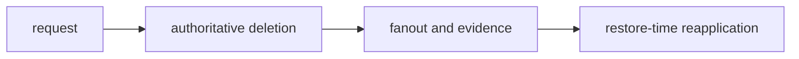

# A04.37 · data privacy deletions

[Phase index](../README.md) · [Principal] · 25–40 minutes

Prerequisite [A04.36](A04.36.md) · Next [Exit gate](../README.md#practice-and-exit-gate)

## 1. The problem & why it exists

Deleting a row leaves personal data in search, backups, and replicas. Inventory copies, verify completion, and keep identifiers in deletion evidence minimal. Obtain policy guidance for legal obligations.

## 2. Visual mental model



```text
01. request
02. authoritative deletion
03. fanout and evidence
04. restore-time reapplication
```

Follow the responsibilities in order. The fixture isolates one mechanism. Check the engine and observation point before attributing the result to an actual deployment.

## 3. Step-by-step mechanism & minimal dry-run

Deletion is a workflow across live stores, derived indexes, caches and backup retention. Durable tombstones or purge records can prevent reintroducing data during restore. Retention exceptions depend on policy and jurisdiction.

**Trace.** request → authoritative deletion → fanout and evidence → restore-time reapplication.

## 4. Formal rigor & quantitative math

If six copies each take up to 2 h and run in parallel, the lower operational bound is the slowest copy, not 12 serial hours; backup expiry may dominate.

Predict the worked quantities by hand, then run the [example](../examples/A04.37.py). It uses a small calculation or state model. For arithmetic, retain the units attached to the worked formula.

## 5. Progressive design

| Run | Expected fixture result | Interpretation |
| --- | --- | --- |
| Failure control | `12` | Which assumption from the opening problem leads to this result? |
| Normal control | `2` | Inventory copies, verify completion, and keep identifiers in deletion evidence minimal. Obtain policy guidance for legal obligations. |

When the fixture reports a modeled value, use the lab to check the corresponding engine behavior. Compare work per request, retained bytes, and operational consequences only where the model measures them.

## 6. Safe local lab & controlled failure injection

```sh
uv run python "01-architecture-A01-to-A20/A04-databases-sql-and-storage-engines/examples/A04.37.py"
uv run python "01-architecture-A01-to-A20/A04-databases-sql-and-storage-engines/examples/A04.37.py" --break
```

Predict both results and identify which input or branch changes. Rerun the normal control as a repair. In a scratch copy, change one key, bound or assumption and predict the result again. Remove the scratch copy after recording your evidence. Apply this reasoning in [L4](../labs/L4.md).

## 7. Production & multi-cloud bridge

Inventory copies, verify completion, and keep identifiers in deletion evidence minimal. Obtain policy guidance for legal obligations. For deployments on AWS, Azure or Google Cloud, confirm engine version, responsibility for maintenance and which metrics the service exposes. Run production comparisons with the same query mix and recovery objective.

<details>
<summary>Principal question and answer</summary>

What evidence would distinguish the opening failure from a storage-capacity problem? Start with the first divergent boundary in the trace and name the exact mechanism. Deletion is a workflow across live stores, derived indexes, caches and backup retention. Durable tombstones or purge records can prevent reintroducing data during restore. Retention exceptions depend on policy and jurisdiction.

</details>

## 8. Memory hook & mastery checkpoint

1. Name the operation at the first stage in the trace.
2. Explain the normal and broken outputs before running them.
3. Change one input and compute the revised result with units.
4. How would you test this boundary at deployment scale?
5. What is one assumption that limits the fixture?

<details>
<summary>Check your reasoning</summary>

1. request.
2. Normal `2`. Failure `12`.
3. Reapply the relationship in section 4 to your changed inputs.
4. Inventory copies, verify completion, and keep identifiers in deletion evidence minimal. Obtain policy guidance for legal obligations.
5. The example uses a small calculation or state model. Check the primary reference for behavior outside that scope.

</details>

## Standards and implementation notes

- [Primary reference](https://www.postgresql.org/docs/current/continuous-archiving.html)
