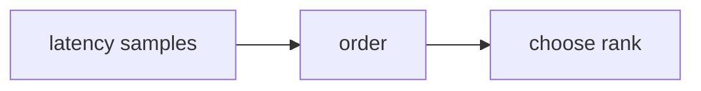

# A05.03 · mean vs percentiles

[Phase index](../README.md) · [Foundation] · 25–40 minutes

Prerequisite [A05.02](A05.02.md) · Next [A05.04](A05.04.md)

## 1. The problem & why it exists

A fast mean obscures a slow subset of requests. Publish sample size and quantile convention. Aggregate distributions rather than averaging per-host percentiles.

## 2. Visual mental model



```text
01. latency samples
02. order
03. choose rank
```

Follow the responsibilities in order. The fixture isolates one mechanism. Check the workload and observation point before attributing the result to an actual deployment.

## 3. Step-by-step mechanism & minimal dry-run

An arithmetic mean weights values directly. A percentile is an order statistic or estimate computed under a specified convention. The nearest-rank p95 selects the value at rank ceil(0.95n).

**Trace.** latency samples → order → choose rank.

## 4. Formal rigor & quantitative math

Nineteen 10 ms requests and one 210 ms request have a mean of 20 ms. Nearest-rank p99 is 210 ms.

Predict the worked quantities by hand, then run the [example](../examples/A05.03.py). It uses a small calculation or state model. For arithmetic, retain the units attached to the worked formula.

## 5. Progressive design

| Run | Expected fixture result | Interpretation |
| --- | --- | --- |
| Failure control | `20` | Which assumption from the opening problem leads to this result? |
| Normal control | `210` | Publish sample size and quantile convention. Aggregate distributions rather than averaging per-host percentiles. |

When the fixture reports a modeled value, use the lab to check the corresponding workload behavior. Compare work per request, retained bytes, and operational consequences only where the model measures them.

## 6. Safe local lab & controlled failure injection

```sh
uv run python "01-architecture-A01-to-A20/A05-scalability-caching-performance/examples/A05.03.py"
uv run python "01-architecture-A01-to-A20/A05-scalability-caching-performance/examples/A05.03.py" --break
```

Predict both results and identify which input or branch changes. Rerun the normal control as a repair. In a scratch copy, change one key, bound or assumption and predict the result again. Remove the scratch copy after recording your evidence. Apply this reasoning in [L3](../labs/L3.md).

## 7. Production & multi-cloud bridge

Publish sample size and quantile convention. Aggregate distributions rather than averaging per-host percentiles. For deployments on AWS, Azure or Google Cloud, confirm quotas, limits and which observations are available at each service boundary. Run production comparisons with the same query mix and recovery objective.

<details>
<summary>Principal question and answer</summary>

What evidence would distinguish the opening failure from a storage-capacity problem? Start with the first divergent boundary in the trace and name the exact mechanism. An arithmetic mean weights values directly. A percentile is an order statistic or estimate computed under a specified convention. The nearest-rank p95 selects the value at rank ceil(0.95n).

</details>

## 8. Memory hook & mastery checkpoint

1. Name the operation at the first stage in the trace.
2. Explain the normal and broken outputs before running them.
3. Change one input and compute the revised result with units.
4. How would you test this boundary at deployment scale?
5. What is one assumption that limits the fixture?

<details>
<summary>Check your reasoning</summary>

1. latency samples.
2. Normal `210`. Failure `20`.
3. Reapply the relationship in section 4 to your changed inputs.
4. Publish sample size and quantile convention. Aggregate distributions rather than averaging per-host percentiles.
5. The example uses a small calculation or state model. Check the primary reference for behavior outside that scope.

</details>

## Standards and implementation notes

- [Primary reference](https://prometheus.io/docs/practices/histograms/)
