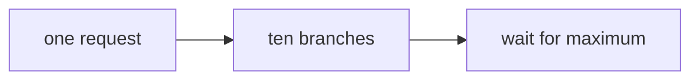

# A05.04 · p95/p99 and tail latency

[Phase index](../README.md) · [Foundation] · 25–40 minutes

Prerequisite [A05.03](A05.03.md) · Next [A05.05](A05.05.md)

## 1. The problem & why it exists

A fan-out service violates latency goals even though each dependency is usually fast. Measure joint behavior, allocate latency budgets across hops, and bound fan-out where possible.

## 2. Visual mental model



```text
01. one request
02. ten branches
03. wait for maximum
```

Follow the responsibilities in order. The fixture isolates one mechanism. Check the workload and observation point before attributing the result to an actual deployment.

## 3. Step-by-step mechanism & minimal dry-run

Request completion can depend on the slowest branch. Independence is an assumption. Common overload or shared infrastructure can correlate tails.

**Trace.** one request → ten branches → wait for maximum.

## 4. Formal rigor & quantitative math

If each of ten independent branches meets the threshold 99% of the time, all ten meet it with probability 0.99^10≈90.44%.

Predict the worked quantities by hand, then run the [example](../examples/A05.04.py). It uses a small calculation or state model. For arithmetic, retain the units attached to the worked formula.

## 5. Progressive design

| Run | Expected fixture result | Interpretation |
| --- | --- | --- |
| Failure control | `0.99` | Which assumption from the opening problem leads to this result? |
| Normal control | `0.9044` | Measure joint behavior, allocate latency budgets across hops, and bound fan-out where possible. |

When the fixture reports a modeled value, use the lab to check the corresponding workload behavior. Compare work per request, retained bytes, and operational consequences only where the model measures them.

## 6. Safe local lab & controlled failure injection

```sh
uv run python "01-architecture-A01-to-A20/A05-scalability-caching-performance/examples/A05.04.py"
uv run python "01-architecture-A01-to-A20/A05-scalability-caching-performance/examples/A05.04.py" --break
```

Predict both results and identify which input or branch changes. Rerun the normal control as a repair. In a scratch copy, change one key, bound or assumption and predict the result again. Remove the scratch copy after recording your evidence. Apply this reasoning in [L3](../labs/L3.md).

## 7. Production & multi-cloud bridge

Measure joint behavior, allocate latency budgets across hops, and bound fan-out where possible. For deployments on AWS, Azure or Google Cloud, confirm quotas, limits and which observations are available at each service boundary. Run production comparisons with the same query mix and recovery objective.

<details>
<summary>Principal question and answer</summary>

What evidence would distinguish the opening failure from a storage-capacity problem? Start with the first divergent boundary in the trace and name the exact mechanism. Request completion can depend on the slowest branch. Independence is an assumption. Common overload or shared infrastructure can correlate tails.

</details>

## 8. Memory hook & mastery checkpoint

1. Name the operation at the first stage in the trace.
2. Explain the normal and broken outputs before running them.
3. Change one input and compute the revised result with units.
4. How would you test this boundary at deployment scale?
5. What is one assumption that limits the fixture?

<details>
<summary>Check your reasoning</summary>

1. one request.
2. Normal `0.9044`. Failure `0.99`.
3. Reapply the relationship in section 4 to your changed inputs.
4. Measure joint behavior, allocate latency budgets across hops, and bound fan-out where possible.
5. The example uses a small calculation or state model. Check the primary reference for behavior outside that scope.

</details>

## Standards and implementation notes

- [Primary reference](https://prometheus.io/docs/practices/histograms/)
