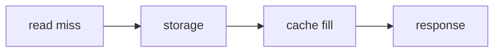

# A05.12 · cache-aside/read-through/write-through

[Phase index](../README.md) · [Core] · 25–40 minutes

Prerequisite [A05.11](A05.11.md) · Next [A05.13](A05.13.md)

## 1. The problem & why it exists

Clients expect cache updates to be atomic with database commits. Name the source of truth and set clear rules for write ordering, failures and invalidation.

## 2. Visual mental model



```text
01. read miss
02. storage
03. cache fill
04. response
```

Follow the responsibilities in order. The fixture isolates one mechanism. Check the workload and observation point before attributing the result to an actual deployment.

## 3. Step-by-step mechanism & minimal dry-run

Cache-aside fills a cache on a miss. Read-through delegates loading to a cache layer. Write-through synchronously forwards writes under that design's contract; partial failure still matters.

**Trace.** read miss → storage → cache fill → response.

## 4. Formal rigor & quantitative math

With 100 requests and a 95% hit rate, five are expected to invoke origin under the simple one-fill model.

Predict the worked quantities by hand, then run the [example](../examples/A05.12.py). It uses a small calculation or state model. For arithmetic, retain the units attached to the worked formula.

## 5. Progressive design

| Run | Expected fixture result | Interpretation |
| --- | --- | --- |
| Failure control | `100` | Which assumption from the opening problem leads to this result? |
| Normal control | `5` | Name the source of truth and set clear rules for write ordering, failures and invalidation. |

When the fixture reports a modeled value, use the lab to check the corresponding workload behavior. Compare work per request, retained bytes, and operational consequences only where the model measures them.

## 6. Safe local lab & controlled failure injection

```sh
uv run python "01-architecture-A01-to-A20/A05-scalability-caching-performance/examples/A05.12.py"
uv run python "01-architecture-A01-to-A20/A05-scalability-caching-performance/examples/A05.12.py" --break
```

Predict both results and identify which input or branch changes. Rerun the normal control as a repair. In a scratch copy, change one key, bound or assumption and predict the result again. Remove the scratch copy after recording your evidence. Apply this reasoning in [L1](../labs/L1.md).

## 7. Production & multi-cloud bridge

Name the source of truth and set clear rules for write ordering, failures and invalidation. For deployments on AWS, Azure or Google Cloud, confirm quotas, limits and which observations are available at each service boundary. Run production comparisons with the same query mix and recovery objective.

<details>
<summary>Principal question and answer</summary>

What evidence would distinguish the opening failure from a storage-capacity problem? Start with the first divergent boundary in the trace and name the exact mechanism. Cache-aside fills a cache on a miss. Read-through delegates loading to a cache layer. Write-through synchronously forwards writes under that design's contract; partial failure still matters.

</details>

## 8. Memory hook & mastery checkpoint

1. Name the operation at the first stage in the trace.
2. Explain the normal and broken outputs before running them.
3. Change one input and compute the revised result with units.
4. How would you test this boundary at deployment scale?
5. What is one assumption that limits the fixture?

<details>
<summary>Check your reasoning</summary>

1. read miss.
2. Normal `5`. Failure `100`.
3. Reapply the relationship in section 4 to your changed inputs.
4. Name the source of truth and set clear rules for write ordering, failures and invalidation.
5. The example uses a small calculation or state model. Check the primary reference for behavior outside that scope.

</details>

## Standards and implementation notes

- [Primary reference](https://learn.microsoft.com/en-us/azure/architecture/patterns/cache-aside)
