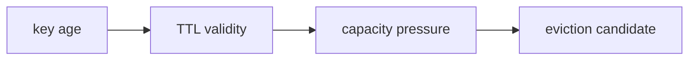

# A05.13 · TTL and eviction

[Phase index](../README.md) · [Core] · 25–40 minutes

Prerequisite [A05.12](A05.12.md) · Next [A05.14](A05.14.md)

## 1. The problem & why it exists

A valid key disappears before its advertised TTL. Handle misses gracefully even when an entry has a TTL. Track evictions and expirations separately.

## 2. Visual mental model



```text
01. key age
02. TTL validity
03. capacity pressure
04. eviction candidate
```

Follow the responsibilities in order. The fixture isolates one mechanism. Check the workload and observation point before attributing the result to an actual deployment.

## 3. Step-by-step mechanism & minimal dry-run

TTL bounds expiry, while eviction can remove eligible entries earlier due to memory policy. Redis eviction behavior depends on the configured policy and memory accounting.

**Trace.** key age → TTL validity; capacity pressure → eviction candidate.

## 4. Formal rigor & quantitative math

If a 200-entry cache receives 250 distinct live keys, at least 50 cannot reside simultaneously under the model.

Predict the worked quantities by hand, then run the [example](../examples/A05.13.py). It uses a small calculation or state model. For arithmetic, retain the units attached to the worked formula.

## 5. Progressive design

| Run | Expected fixture result | Interpretation |
| --- | --- | --- |
| Failure control | `250` | Which assumption from the opening problem leads to this result? |
| Normal control | `50` | Handle misses gracefully even when an entry has a TTL. Track evictions and expirations separately. |

When the fixture reports a modeled value, use the lab to check the corresponding workload behavior. Compare work per request, retained bytes, and operational consequences only where the model measures them.

## 6. Safe local lab & controlled failure injection

```sh
uv run python "01-architecture-A01-to-A20/A05-scalability-caching-performance/examples/A05.13.py"
uv run python "01-architecture-A01-to-A20/A05-scalability-caching-performance/examples/A05.13.py" --break
```

Predict both results and identify which input or branch changes. Rerun the normal control as a repair. In a scratch copy, change one key, bound or assumption and predict the result again. Remove the scratch copy after recording your evidence. Apply this reasoning in [L1](../labs/L1.md).

## 7. Production & multi-cloud bridge

Handle misses gracefully even when an entry has a TTL. Track evictions and expirations separately. For deployments on AWS, Azure or Google Cloud, confirm quotas, limits and which observations are available at each service boundary. Run production comparisons with the same query mix and recovery objective.

<details>
<summary>Principal question and answer</summary>

What evidence would distinguish the opening failure from a storage-capacity problem? Start with the first divergent boundary in the trace and name the exact mechanism. TTL bounds expiry, while eviction can remove eligible entries earlier due to memory policy. Redis eviction behavior depends on the configured policy and memory accounting.

</details>

## 8. Memory hook & mastery checkpoint

1. Name the operation at the first stage in the trace.
2. Explain the normal and broken outputs before running them.
3. Change one input and compute the revised result with units.
4. How would you test this boundary at deployment scale?
5. What is one assumption that limits the fixture?

<details>
<summary>Check your reasoning</summary>

1. key age.
2. Normal `50`. Failure `250`.
3. Reapply the relationship in section 4 to your changed inputs.
4. Handle misses gracefully even when an entry has a TTL. Track evictions and expirations separately.
5. The example uses a small calculation or state model. Check the primary reference for behavior outside that scope.

</details>

## Standards and implementation notes

- [Primary reference](https://redis.io/docs/latest/develop/reference/eviction/)
