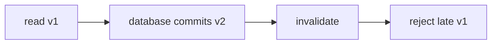

# A05.15 · cache invalidation

[Phase index](../README.md) · [Core] · 25–40 minutes

Prerequisite [A05.14](A05.14.md) · Next [A05.16](A05.16.md)

## 1. The problem & why it exists

An invalidated key is reinserted by an older in-flight request. Use version-aware fills or a documented staleness policy and test interleavings.

## 2. Visual mental model



```text
01. read v1
02. database commits v2
03. invalidate
04. reject late v1
```

Follow the responsibilities in order. The fixture isolates one mechanism. Check the workload and observation point before attributing the result to an actual deployment.

## 3. Step-by-step mechanism & minimal dry-run

An invalidation event does not automatically order concurrent cache fills. A generation or version check can refuse a value older than the invalidation floor.

**Trace.** read v1 → database commits v2 → invalidate → reject late v1.

## 4. Formal rigor & quantitative math

If a stale fill arrives 100 ms after invalidation and remains for 5 s, a naive cache can serve it until roughly 5.1 s after invalidation.

Predict the worked quantities by hand, then run the [example](../examples/A05.15.py). It uses a small calculation or state model. For arithmetic, retain the units attached to the worked formula.

## 5. Progressive design

| Run | Expected fixture result | Interpretation |
| --- | --- | --- |
| Failure control | `1` | Which assumption from the opening problem leads to this result? |
| Normal control | `2` | Use version-aware fills or a documented staleness policy and test interleavings. |

When the fixture reports a modeled value, use the lab to check the corresponding workload behavior. Compare work per request, retained bytes, and operational consequences only where the model measures them.

## 6. Safe local lab & controlled failure injection

```sh
uv run python "01-architecture-A01-to-A20/A05-scalability-caching-performance/examples/A05.15.py"
uv run python "01-architecture-A01-to-A20/A05-scalability-caching-performance/examples/A05.15.py" --break
```

Predict both results and identify which input or branch changes. Rerun the normal control as a repair. In a scratch copy, change one key, bound or assumption and predict the result again. Remove the scratch copy after recording your evidence. Apply this reasoning in [L1](../labs/L1.md).

## 7. Production & multi-cloud bridge

Use version-aware fills or a documented staleness policy and test interleavings. For deployments on AWS, Azure or Google Cloud, confirm quotas, limits and which observations are available at each service boundary. Run production comparisons with the same query mix and recovery objective.

<details>
<summary>Principal question and answer</summary>

What evidence would distinguish the opening failure from a storage-capacity problem? Start with the first divergent boundary in the trace and name the exact mechanism. An invalidation event does not automatically order concurrent cache fills. A generation or version check can refuse a value older than the invalidation floor.

</details>

## 8. Memory hook & mastery checkpoint

1. Name the operation at the first stage in the trace.
2. Explain the normal and broken outputs before running them.
3. Change one input and compute the revised result with units.
4. How would you test this boundary at deployment scale?
5. What is one assumption that limits the fixture?

<details>
<summary>Check your reasoning</summary>

1. read v1.
2. Normal `2`. Failure `1`.
3. Reapply the relationship in section 4 to your changed inputs.
4. Use version-aware fills or a documented staleness policy and test interleavings.
5. The example uses a small calculation or state model. Check the primary reference for behavior outside that scope.

</details>

## Standards and implementation notes

- [Primary reference](https://learn.microsoft.com/en-us/azure/architecture/patterns/cache-aside)
