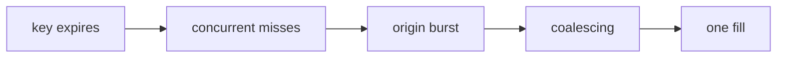

# A05.16 · cache stampedes and hot keys

[Phase index](../README.md) · [Core] · 25–40 minutes

Prerequisite [A05.15](A05.15.md) · Next [A05.17](A05.17.md)

## 1. The problem & why it exists

A cache expiry sends thousands of concurrent reads to one origin key. Combine jitter, request coalescing, and controlled origin admission as appropriate.

## 2. Visual mental model



```text
01. key expires
02. concurrent misses
03. origin burst
04. coalescing
05. one fill
```

Follow the responsibilities in order. The fixture isolates one mechanism. Check the workload and observation point before attributing the result to an actual deployment.

## 3. Step-by-step mechanism & minimal dry-run

Stampedes occur when many clients miss at once and refill independently. Hot keys skew load even when aggregate capacity looks healthy.

**Trace.** key expires → concurrent misses → origin burst; coalescing → one fill.

## 4. Formal rigor & quantitative math

For 400 concurrent misses on one key, a per-process single-flight with four independent processes can reduce origin fills toward four instead of 400.

Predict the worked quantities by hand, then run the [example](../examples/A05.16.py). It uses a small calculation or state model. For arithmetic, retain the units attached to the worked formula.

## 5. Progressive design

| Run | Expected fixture result | Interpretation |
| --- | --- | --- |
| Failure control | `400` | Which assumption from the opening problem leads to this result? |
| Normal control | `4` | Combine jitter, request coalescing, and controlled origin admission as appropriate. |

When the fixture reports a modeled value, use the lab to check the corresponding workload behavior. Compare work per request, retained bytes, and operational consequences only where the model measures them.

## 6. Safe local lab & controlled failure injection

```sh
uv run python "01-architecture-A01-to-A20/A05-scalability-caching-performance/examples/A05.16.py"
uv run python "01-architecture-A01-to-A20/A05-scalability-caching-performance/examples/A05.16.py" --break
```

Predict both results and identify which input or branch changes. Rerun the normal control as a repair. In a scratch copy, change one key, bound or assumption and predict the result again. Remove the scratch copy after recording your evidence. Apply this reasoning in [L1](../labs/L1.md).

## 7. Production & multi-cloud bridge

Combine jitter, request coalescing, and controlled origin admission as appropriate. For deployments on AWS, Azure or Google Cloud, confirm quotas, limits and which observations are available at each service boundary. Run production comparisons with the same query mix and recovery objective.

<details>
<summary>Principal question and answer</summary>

What evidence would distinguish the opening failure from a storage-capacity problem? Start with the first divergent boundary in the trace and name the exact mechanism. Stampedes occur when many clients miss at once and refill independently. Hot keys skew load even when aggregate capacity looks healthy.

</details>

## 8. Memory hook & mastery checkpoint

1. Name the operation at the first stage in the trace.
2. Explain the normal and broken outputs before running them.
3. Change one input and compute the revised result with units.
4. How would you test this boundary at deployment scale?
5. What is one assumption that limits the fixture?

<details>
<summary>Check your reasoning</summary>

1. key expires.
2. Normal `4`. Failure `400`.
3. Reapply the relationship in section 4 to your changed inputs.
4. Combine jitter, request coalescing, and controlled origin admission as appropriate.
5. The example uses a small calculation or state model. Check the primary reference for behavior outside that scope.

</details>

## Standards and implementation notes

- [Primary reference](https://sre.google/sre-book/addressing-cascading-failures/)
