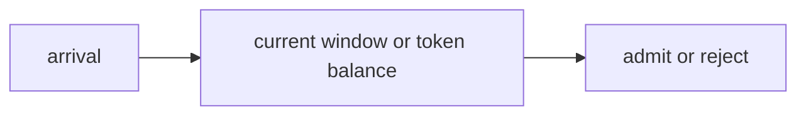

# A05.21 · rate limiter windows, token bucket/leaky bucket

[Phase index](../README.md) · [Core] · 25–40 minutes

Prerequisite [A05.20](A05.20.md) · Next [A05.22](A05.22.md)

## 1. The problem & why it exists

A fixed-window limiter allows twice the nominal rate at a boundary. Choose semantics for bursts and fairness, and use shared atomic counters for distributed quotas.

## 2. Visual mental model



```text
01. arrival
02. current window or token balance
03. admit or reject
```

Follow the responsibilities in order. The fixture isolates one mechanism. Check the workload and observation point before attributing the result to an actual deployment.

## 3. Step-by-step mechanism & minimal dry-run

Fixed windows reset together. Sliding windows count usage in a trailing interval. Token buckets permit a burst and refill; leaky-bucket terminology can mean shaping departure or metering arrivals depending on context.

**Trace.** arrival → current window or token balance → admit or reject.

## 4. Formal rigor & quantitative math

A 10-per-second fixed window can admit 20 at t=0.999 and t=1.001 across two windows. A trailing one-second cap of 10 rejects the second group.

Predict the worked quantities by hand, then run the [example](../examples/A05.21.py). It uses a small calculation or state model. For arithmetic, retain the units attached to the worked formula.

## 5. Progressive design

| Run | Expected fixture result | Interpretation |
| --- | --- | --- |
| Failure control | `20` | Which assumption from the opening problem leads to this result? |
| Normal control | `10` | Choose semantics for bursts and fairness, and use shared atomic counters for distributed quotas. |

When the fixture reports a modeled value, use the lab to check the corresponding workload behavior. Compare work per request, retained bytes, and operational consequences only where the model measures them.

## 6. Safe local lab & controlled failure injection

```sh
uv run python "01-architecture-A01-to-A20/A05-scalability-caching-performance/examples/A05.21.py"
uv run python "01-architecture-A01-to-A20/A05-scalability-caching-performance/examples/A05.21.py" --break
```

Predict both results and identify which input or branch changes. Rerun the normal control as a repair. In a scratch copy, change one key, bound or assumption and predict the result again. Remove the scratch copy after recording your evidence. Apply this reasoning in [L4](../labs/L4.md).

## 7. Production & multi-cloud bridge

Choose semantics for bursts and fairness, and use shared atomic counters for distributed quotas. For deployments on AWS, Azure or Google Cloud, confirm quotas, limits and which observations are available at each service boundary. Run production comparisons with the same query mix and recovery objective.

<details>
<summary>Principal question and answer</summary>

What evidence would distinguish the opening failure from a storage-capacity problem? Start with the first divergent boundary in the trace and name the exact mechanism. Fixed windows reset together. Sliding windows count usage in a trailing interval. Token buckets permit a burst and refill; leaky-bucket terminology can mean shaping departure or metering arrivals depending on context.

</details>

## 8. Memory hook & mastery checkpoint

1. Name the operation at the first stage in the trace.
2. Explain the normal and broken outputs before running them.
3. Change one input and compute the revised result with units.
4. How would you test this boundary at deployment scale?
5. What is one assumption that limits the fixture?

<details>
<summary>Check your reasoning</summary>

1. arrival.
2. Normal `10`. Failure `20`.
3. Reapply the relationship in section 4 to your changed inputs.
4. Choose semantics for bursts and fairness, and use shared atomic counters for distributed quotas.
5. The example uses a small calculation or state model. Check the primary reference for behavior outside that scope.

</details>

## Standards and implementation notes

- [Primary reference](https://www.rfc-editor.org/rfc/rfc2697.html)
