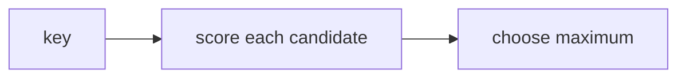

# A05.27 · consistent/rendezvous hashing

[Phase index](../README.md) · [Principal] · 25–40 minutes

Prerequisite [A05.26](A05.26.md) · Next [A05.28](A05.28.md)

## 1. The problem & why it exists

A node addition causes a broad cold-cache event. Use a stable hash across runtimes and test weights, membership epochs and hot-key skew.

## 2. Visual mental model



```text
01. key
02. score each candidate
03. choose maximum
```

Follow the responsibilities in order. The fixture isolates one mechanism. Check the workload and observation point before attributing the result to an actual deployment.

## 3. Step-by-step mechanism & minimal dry-run

Consistent hashing and rendezvous hashing seek stable placement under membership changes. Rendezvous picks the highest stable key-node score; adding a node can only move a key to the added node.

**Trace.** key → score each candidate → choose maximum.

## 4. Formal rigor & quantitative math

With three existing equal nodes and one added node, the new node wins about one-quarter of keys under uniform independent scores.

Predict the worked quantities by hand, then run the [example](../examples/A05.27.py). It uses a small calculation or state model. For arithmetic, retain the units attached to the worked formula.

## 5. Progressive design

| Run | Expected fixture result | Interpretation |
| --- | --- | --- |
| Failure control | `0.75` | Which assumption from the opening problem leads to this result? |
| Normal control | `0.25` | Use a stable hash across runtimes and test weights, membership epochs and hot-key skew. |

When the fixture reports a modeled value, use the lab to check the corresponding workload behavior. Compare work per request, retained bytes, and operational consequences only where the model measures them.

## 6. Safe local lab & controlled failure injection

```sh
uv run python "01-architecture-A01-to-A20/A05-scalability-caching-performance/examples/A05.27.py"
uv run python "01-architecture-A01-to-A20/A05-scalability-caching-performance/examples/A05.27.py" --break
```

Predict both results and identify which input or branch changes. Rerun the normal control as a repair. In a scratch copy, change one key, bound or assumption and predict the result again. Remove the scratch copy after recording your evidence. Apply this reasoning in [L2](../labs/L2.md).

## 7. Production & multi-cloud bridge

Use a stable hash across runtimes and test weights, membership epochs and hot-key skew. For deployments on AWS, Azure or Google Cloud, confirm quotas, limits and which observations are available at each service boundary. Run production comparisons with the same query mix and recovery objective.

<details>
<summary>Principal question and answer</summary>

What evidence would distinguish the opening failure from a storage-capacity problem? Start with the first divergent boundary in the trace and name the exact mechanism. Consistent hashing and rendezvous hashing seek stable placement under membership changes. Rendezvous picks the highest stable key-node score; adding a node can only move a key to the added node.

</details>

## 8. Memory hook & mastery checkpoint

1. Name the operation at the first stage in the trace.
2. Explain the normal and broken outputs before running them.
3. Change one input and compute the revised result with units.
4. How would you test this boundary at deployment scale?
5. What is one assumption that limits the fixture?

<details>
<summary>Check your reasoning</summary>

1. key.
2. Normal `0.25`. Failure `0.75`.
3. Reapply the relationship in section 4 to your changed inputs.
4. Use a stable hash across runtimes and test weights, membership epochs and hot-key skew.
5. The example uses a small calculation or state model. Check the primary reference for behavior outside that scope.

</details>

## Standards and implementation notes

- [Primary reference](https://redis.io/docs/latest/develop/reference/eviction/)
