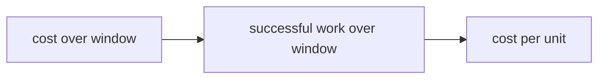

# A05.30 · cost-aware scaling

[Phase index](../README.md) · [Principal] · 25–40 minutes

Prerequisite [A05.29](A05.29.md) · Next [A05.31](A05.31.md)

## 1. The problem & why it exists

An autoscaling change lowers CPU cost but raises per-request expense. Record the scope and use measured rates. Avoid using this made-up example as current cloud pricing.

## 2. Visual mental model



```text
01. cost over window
02. successful work over window
03. cost per unit
```

Follow the responsibilities in order. The fixture isolates one mechanism. Check the workload and observation point before attributing the result to an actual deployment.

## 3. Step-by-step mechanism & minimal dry-run

Unit cost includes compute, storage, network, downstream and idle capacity over a common window. Compare successful work and reliability outcomes.

**Trace.** cost over window → successful work over window → cost per unit.

## 4. Formal rigor & quantitative math

At 12 currency units/hour and 60000 successes/hour, cost is 0.0002 per success. At 30000 successes/hour with the same spend it doubles.

Predict the worked quantities by hand, then run the [example](../examples/A05.30.py). It uses a small calculation or state model. For arithmetic, retain the units attached to the worked formula.

## 5. Progressive design

| Run | Expected fixture result | Interpretation |
| --- | --- | --- |
| Failure control | `0.0004` | Which assumption from the opening problem leads to this result? |
| Normal control | `0.0002` | Record the scope and use measured rates. Avoid using this made-up example as current cloud pricing. |

When the fixture reports a modeled value, use the lab to check the corresponding workload behavior. Compare work per request, retained bytes, and operational consequences only where the model measures them.

## 6. Safe local lab & controlled failure injection

```sh
uv run python "01-architecture-A01-to-A20/A05-scalability-caching-performance/examples/A05.30.py"
uv run python "01-architecture-A01-to-A20/A05-scalability-caching-performance/examples/A05.30.py" --break
```

Predict both results and identify which input or branch changes. Rerun the normal control as a repair. In a scratch copy, change one key, bound or assumption and predict the result again. Remove the scratch copy after recording your evidence. Apply this reasoning in [L3](../labs/L3.md).

## 7. Production & multi-cloud bridge

Record the scope and use measured rates. Avoid using this made-up example as current cloud pricing. For deployments on AWS, Azure or Google Cloud, confirm quotas, limits and which observations are available at each service boundary. Run production comparisons with the same query mix and recovery objective.

<details>
<summary>Principal question and answer</summary>

What evidence would distinguish the opening failure from a storage-capacity problem? Start with the first divergent boundary in the trace and name the exact mechanism. Unit cost includes compute, storage, network, downstream and idle capacity over a common window. Compare successful work and reliability outcomes.

</details>

## 8. Memory hook & mastery checkpoint

1. Name the operation at the first stage in the trace.
2. Explain the normal and broken outputs before running them.
3. Change one input and compute the revised result with units.
4. How would you test this boundary at deployment scale?
5. What is one assumption that limits the fixture?

<details>
<summary>Check your reasoning</summary>

1. cost over window.
2. Normal `0.0002`. Failure `0.0004`.
3. Reapply the relationship in section 4 to your changed inputs.
4. Record the scope and use measured rates. Avoid using this made-up example as current cloud pricing.
5. The example uses a small calculation or state model. Check the primary reference for behavior outside that scope.

</details>

## Standards and implementation notes

- [Primary reference](https://sre.google/sre-book/addressing-cascading-failures/)
