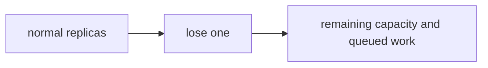

# A05.33 · failure headroom

[Phase index](../README.md) · [Principal] · 25–40 minutes

Prerequisite [A05.32](A05.32.md) · Next [A05.34](A05.34.md)

## 1. The problem & why it exists

A system is safe at peak only while every replica is healthy. Size for named failure scenarios and check recovery traffic and load redistribution.

## 2. Visual mental model



```text
01. normal replicas
02. lose one
03. remaining capacity and queued work
```

Follow the responsibilities in order. The fixture isolates one mechanism. Check the workload and observation point before attributing the result to an actual deployment.

## 3. Step-by-step mechanism & minimal dry-run

Failure headroom is capacity held against degraded operation and recovery. Verify dependencies and shared failure domains before counting interchangeable replicas.

**Trace.** normal replicas → lose one → remaining capacity and queued work.

## 4. Formal rigor & quantitative math

At 600 RPS required and 200 RPS safe capacity per replica, three cover normal load. Four cover the same load after one fails in this ideal model.

Predict the worked quantities by hand, then run the [example](../examples/A05.33.py). It uses a small calculation or state model. For arithmetic, retain the units attached to the worked formula.

## 5. Progressive design

| Run | Expected fixture result | Interpretation |
| --- | --- | --- |
| Failure control | `3` | Which assumption from the opening problem leads to this result? |
| Normal control | `4` | Size for named failure scenarios and check recovery traffic and load redistribution. |

When the fixture reports a modeled value, use the lab to check the corresponding workload behavior. Compare work per request, retained bytes, and operational consequences only where the model measures them.

## 6. Safe local lab & controlled failure injection

```sh
uv run python "01-architecture-A01-to-A20/A05-scalability-caching-performance/examples/A05.33.py"
uv run python "01-architecture-A01-to-A20/A05-scalability-caching-performance/examples/A05.33.py" --break
```

Predict both results and identify which input or branch changes. Rerun the normal control as a repair. In a scratch copy, change one key, bound or assumption and predict the result again. Remove the scratch copy after recording your evidence. Apply this reasoning in [L3](../labs/L3.md).

## 7. Production & multi-cloud bridge

Size for named failure scenarios and check recovery traffic and load redistribution. For deployments on AWS, Azure or Google Cloud, confirm quotas, limits and which observations are available at each service boundary. Run production comparisons with the same query mix and recovery objective.

<details>
<summary>Principal question and answer</summary>

What evidence would distinguish the opening failure from a storage-capacity problem? Start with the first divergent boundary in the trace and name the exact mechanism. Failure headroom is capacity held against degraded operation and recovery. Verify dependencies and shared failure domains before counting interchangeable replicas.

</details>

## 8. Memory hook & mastery checkpoint

1. Name the operation at the first stage in the trace.
2. Explain the normal and broken outputs before running them.
3. Change one input and compute the revised result with units.
4. How would you test this boundary at deployment scale?
5. What is one assumption that limits the fixture?

<details>
<summary>Check your reasoning</summary>

1. normal replicas.
2. Normal `4`. Failure `3`.
3. Reapply the relationship in section 4 to your changed inputs.
4. Size for named failure scenarios and check recovery traffic and load redistribution.
5. The example uses a small calculation or state model. Check the primary reference for behavior outside that scope.

</details>

## Standards and implementation notes

- [Primary reference](https://sre.google/sre-book/addressing-cascading-failures/)
