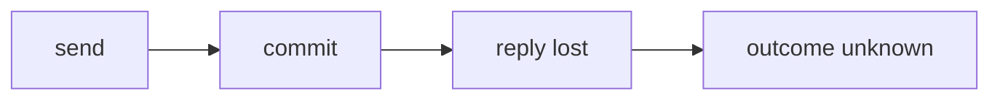

# A06.01 · partial failure

[Phase index](../README.md) · [Foundation] · 25–40 minutes

Prerequisite [A05 gate](../../A05-scalability-caching-performance/README.md#practice-and-exit-gate) · Next [A06.02](A06.02.md)

## 1. The problem & why it exists

The client times out after a write, while the server already committed. Record operation IDs and outcomes at the owner. Avoid treating a timeout as proof no write happened.

## 2. Visual mental model



```text
01. send
02. commit
03. reply lost
04. outcome unknown
```

Follow the responsibilities in order. The fixture isolates one mechanism. Check the workload and observation point before attributing the result to an actual deployment.

## 3. Step-by-step mechanism & minimal dry-run

Partial failure means components have different observations and progress. A client timeout alone cannot distinguish a lost request from a lost reply. Use a durable operation identity or a separate outcome query.

**Trace.** send → commit → reply lost → outcome unknown.

## 4. Formal rigor & quantitative math

With one original attempt and two retries, up to three deliveries can occur. Correct scoped deduplication reduces three equal deliveries to one effect.

Predict the worked quantities by hand, then run the [example](../examples/A06.01.py). It uses a small calculation or state model. For arithmetic, retain the units attached to the worked formula.

## 5. Progressive design

| Run | Expected fixture result | Interpretation |
| --- | --- | --- |
| Failure control | `3` | Which assumption from the opening problem leads to this result? |
| Normal control | `1` | Record operation IDs and outcomes at the owner. Avoid treating a timeout as proof no write happened. |

When the fixture reports a modeled value, use the lab to check the corresponding workload behavior. Compare work per request, retained bytes, and operational consequences only where the model measures them.

## 6. Safe local lab & controlled failure injection

```sh
uv run python "01-architecture-A01-to-A20/A06-distributed-systems-coordination/examples/A06.01.py"
uv run python "01-architecture-A01-to-A20/A06-distributed-systems-coordination/examples/A06.01.py" --break
```

Predict both results and identify which input or branch changes. Rerun the normal control as a repair. In a scratch copy, change one key, bound or assumption and predict the result again. Remove the scratch copy after recording your evidence. Apply this reasoning in [L2](../labs/L2.md).

## 7. Production & multi-cloud bridge

Record operation IDs and outcomes at the owner. Avoid treating a timeout as proof no write happened. For deployments on AWS, Azure or Google Cloud, confirm quotas, limits and which observations are available at each service boundary. Run production comparisons with the same query mix and recovery objective.

<details>
<summary>Principal question and answer</summary>

What evidence would distinguish the opening failure from a storage-capacity problem? Start with the first divergent boundary in the trace and name the exact mechanism. Partial failure means components have different observations and progress. A client timeout alone cannot distinguish a lost request from a lost reply. Use a durable operation identity or a separate outcome query.

</details>

## 8. Memory hook & mastery checkpoint

1. Name the operation at the first stage in the trace.
2. Explain the normal and broken outputs before running them.
3. Change one input and compute the revised result with units.
4. How would you test this boundary at deployment scale?
5. What is one assumption that limits the fixture?

<details>
<summary>Check your reasoning</summary>

1. send.
2. Normal `1`. Failure `3`.
3. Reapply the relationship in section 4 to your changed inputs.
4. Record operation IDs and outcomes at the owner. Avoid treating a timeout as proof no write happened.
5. The example uses a small calculation or state model. Check the primary reference for behavior outside that scope.

</details>

## Standards and implementation notes

- [Primary reference](https://aws.amazon.com/builders-library/timeouts-retries-and-backoff-with-jitter/)
