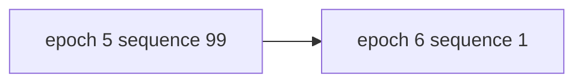

# A06.07 · monotonic sequence numbers

[Phase index](../README.md) · [Foundation] · 25–40 minutes

Prerequisite [A06.06](A06.06.md) · Next [A06.08](A06.08.md)

## 1. The problem & why it exists

A producer restarts and assigns an earlier sequence number to a new update. Apply the epoch and sequence atomically and reject older or duplicate claims at the resource.

## 2. Visual mental model



```text
01. epoch 5 sequence 99
02. epoch 6 sequence 1
```

Follow the responsibilities in order. The fixture isolates one mechanism. Check the workload and observation point before attributing the result to an actual deployment.

## 3. Step-by-step mechanism & minimal dry-run

Sequences compare claims within their scope. Persist the counter or pair it with a fenced term or epoch. Gaps require a policy; monotonic increase does not imply contiguous data.

**Trace.** epoch 5 sequence 99 → epoch 6 sequence 1.

## 4. Formal rigor & quantitative math

Lexicographically (6,1) exceeds (5,99) even though the local counter decreased from 99 to 1.

Predict the worked quantities by hand, then run the [example](../examples/A06.07.py). It uses a small calculation or state model. For arithmetic, retain the units attached to the worked formula.

## 5. Progressive design

| Run | Expected fixture result | Interpretation |
| --- | --- | --- |
| Failure control | `False` | Which assumption from the opening problem leads to this result? |
| Normal control | `True` | Apply the epoch and sequence atomically and reject older or duplicate claims at the resource. |

When the fixture reports a modeled value, use the lab to check the corresponding workload behavior. Compare work per request, retained bytes, and operational consequences only where the model measures them.

## 6. Safe local lab & controlled failure injection

```sh
uv run python "01-architecture-A01-to-A20/A06-distributed-systems-coordination/examples/A06.07.py"
uv run python "01-architecture-A01-to-A20/A06-distributed-systems-coordination/examples/A06.07.py" --break
```

Predict both results and identify which input or branch changes. Rerun the normal control as a repair. In a scratch copy, change one key, bound or assumption and predict the result again. Remove the scratch copy after recording your evidence. Apply this reasoning in [L1](../labs/L1.md).

## 7. Production & multi-cloud bridge

Apply the epoch and sequence atomically and reject older or duplicate claims at the resource. For deployments on AWS, Azure or Google Cloud, confirm quotas, limits and which observations are available at each service boundary. Run production comparisons with the same query mix and recovery objective.

<details>
<summary>Principal question and answer</summary>

What evidence would distinguish the opening failure from a storage-capacity problem? Start with the first divergent boundary in the trace and name the exact mechanism. Sequences compare claims within their scope. Persist the counter or pair it with a fenced term or epoch. Gaps require a policy; monotonic increase does not imply contiguous data.

</details>

## 8. Memory hook & mastery checkpoint

1. Name the operation at the first stage in the trace.
2. Explain the normal and broken outputs before running them.
3. Change one input and compute the revised result with units.
4. How would you test this boundary at deployment scale?
5. What is one assumption that limits the fixture?

<details>
<summary>Check your reasoning</summary>

1. epoch 5 sequence 99.
2. Normal `True`. Failure `False`.
3. Reapply the relationship in section 4 to your changed inputs.
4. Apply the epoch and sequence atomically and reject older or duplicate claims at the resource.
5. The example uses a small calculation or state model. Check the primary reference for behavior outside that scope.

</details>

## Standards and implementation notes

- [Primary reference](https://raft.github.io/raft.pdf)
