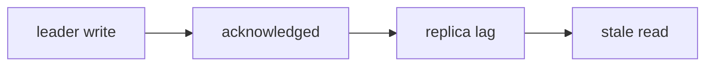

# A06.10 · consistency models

[Phase index](../README.md) · [Core] · 25–40 minutes

Prerequisite [A06.09](A06.09.md) · Next [A06.11](A06.11.md)

## 1. The problem & why it exists

A read replica returns an older value than the user just wrote. Match the requirement to the user's read path and measure replay lag independently.

## 2. Visual mental model



```text
01. leader write
02. acknowledged
03. replica lag
04. stale read
```

Follow the responsibilities in order. The fixture isolates one mechanism. Check the workload and observation point before attributing the result to an actual deployment.

## 3. Step-by-step mechanism & minimal dry-run

Consistency models constrain permitted histories. Read-your-writes, eventual convergence and linearizability describe different properties and boundaries.

**Trace.** leader write → acknowledged → replica lag → stale read.

## 4. Formal rigor & quantitative math

A replica applying 80 changes/s against 100 writes/s falls behind by 20 per second when load persists, under a simple rate model.

Predict the worked quantities by hand, then run the [example](../examples/A06.10.py). It uses a small calculation or state model. For arithmetic, retain the units attached to the worked formula.

## 5. Progressive design

| Run | Expected fixture result | Interpretation |
| --- | --- | --- |
| Failure control | `100` | Which assumption from the opening problem leads to this result? |
| Normal control | `20` | Match the requirement to the user's read path and measure replay lag independently. |

When the fixture reports a modeled value, use the lab to check the corresponding workload behavior. Compare work per request, retained bytes, and operational consequences only where the model measures them.

## 6. Safe local lab & controlled failure injection

```sh
uv run python "01-architecture-A01-to-A20/A06-distributed-systems-coordination/examples/A06.10.py"
uv run python "01-architecture-A01-to-A20/A06-distributed-systems-coordination/examples/A06.10.py" --break
```

Predict both results and identify which input or branch changes. Rerun the normal control as a repair. In a scratch copy, change one key, bound or assumption and predict the result again. Remove the scratch copy after recording your evidence. Apply this reasoning in [L3](../labs/L3.md).

## 7. Production & multi-cloud bridge

Match the requirement to the user's read path and measure replay lag independently. For deployments on AWS, Azure or Google Cloud, confirm quotas, limits and which observations are available at each service boundary. Run production comparisons with the same query mix and recovery objective.

<details>
<summary>Principal question and answer</summary>

What evidence would distinguish the opening failure from a storage-capacity problem? Start with the first divergent boundary in the trace and name the exact mechanism. Consistency models constrain permitted histories. Read-your-writes, eventual convergence and linearizability describe different properties and boundaries.

</details>

## 8. Memory hook & mastery checkpoint

1. Name the operation at the first stage in the trace.
2. Explain the normal and broken outputs before running them.
3. Change one input and compute the revised result with units.
4. How would you test this boundary at deployment scale?
5. What is one assumption that limits the fixture?

<details>
<summary>Check your reasoning</summary>

1. leader write.
2. Normal `20`. Failure `100`.
3. Reapply the relationship in section 4 to your changed inputs.
4. Match the requirement to the user's read path and measure replay lag independently.
5. The example uses a small calculation or state model. Check the primary reference for behavior outside that scope.

</details>

## Standards and implementation notes

- [Primary reference](https://etcd.io/docs/v3.6/learning/api_guarantees/)
