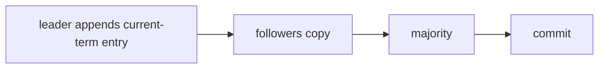

# A06.18 · consensus/Raft

[Phase index](../README.md) · [Core] · 25–40 minutes

Prerequisite [A06.17](A06.17.md) · Next [A06.19](A06.19.md)

## 1. The problem & why it exists

A replicated log commits an entry after hearing from only a minority. Treat membership change, durable state, election and snapshot behavior as protocol requirements.

## 2. Visual mental model



```text
01. leader appends current-term entry
02. followers copy
03. majority
04. commit
```

Follow the responsibilities in order. The fixture isolates one mechanism. Check the workload and observation point before attributing the result to an actual deployment.

## 3. Step-by-step mechanism & minimal dry-run

Raft organizes a consensus log into leader election, replication and safety rules. A leader uses majority replication and an eligible current-term entry to advance its commit index. A simulation can illustrate a subset.

**Trace.** leader appends current-term entry → followers copy → majority → commit.

**Replicate versus commit.** In a three-member group, a term-4 leader appends index 7 term 4. If just the leader has it, it remains uncommitted. After one follower durably stores it and confirms the matching prefix, the leader can advance the commit point. A heartbeat announces the new leader commit index. The apply loop runs in log order, up to that index. Receipt, commitment and application are three distinct points.

**Earlier-term entries.** A leader cannot establish commitment of an earlier-term entry solely by counting copies of that entry. Advancing commitment through a current-term entry also commits its preceding matching prefix. The guided model uses one term and a fixed leader.

## 4. Formal rigor & quantitative math

For 5 nodes, quorum 3. Two acknowledgments including the leader do not commit, three can commit an eligible entry.

Predict the worked quantities by hand, then run the [example](../examples/A06.18.py). It uses a small calculation or state model. For arithmetic, retain the units attached to the worked formula.

## 5. Progressive design

| Run | Expected fixture result | Interpretation |
| --- | --- | --- |
| Failure control | `True` | Which assumption from the opening problem leads to this result? |
| Normal control | `False` | Treat membership change, durable state, election and snapshot behavior as protocol requirements. |

When the fixture reports a modeled value, use the lab to check the corresponding workload behavior. Compare work per request, retained bytes, and operational consequences only where the model measures them.

## 6. Safe local lab & controlled failure injection

```sh
uv run python "01-architecture-A01-to-A20/A06-distributed-systems-coordination/examples/A06.18.py"
uv run python "01-architecture-A01-to-A20/A06-distributed-systems-coordination/examples/A06.18.py" --break
```

Predict both results and identify which input or branch changes. Rerun the normal control as a repair. In a scratch copy, change one key, bound or assumption and predict the result again. Remove the scratch copy after recording your evidence. Apply this reasoning in [L3](../labs/L3.md).

## 7. Production & multi-cloud bridge

Treat membership change, durable state, election and snapshot behavior as protocol requirements. For deployments on AWS, Azure or Google Cloud, confirm quotas, limits and which observations are available at each service boundary. Run production comparisons with the same query mix and recovery objective.

<details>
<summary>Principal question and answer</summary>

What evidence would distinguish the opening failure from a storage-capacity problem? Start with the first divergent boundary in the trace and name the exact mechanism. Raft organizes a consensus log into leader election, replication and safety rules. A leader uses majority replication and an eligible current-term entry to advance its commit index. A simulation can illustrate a subset.

</details>

## 8. Memory hook & mastery checkpoint

1. Name the operation at the first stage in the trace.
2. Explain the normal and broken outputs before running them.
3. Change one input and compute the revised result with units.
4. How would you test this boundary at deployment scale?
5. What is one assumption that limits the fixture?

<details>
<summary>Check your reasoning</summary>

1. leader appends current-term entry.
2. Normal `False`. Failure `True`.
3. Reapply the relationship in section 4 to your changed inputs.
4. Treat membership change, durable state, election and snapshot behavior as protocol requirements.
5. The example uses a small calculation or state model. Check the primary reference for behavior outside that scope.

</details>

## Standards and implementation notes

- [Primary reference](https://raft.github.io/raft.pdf)
