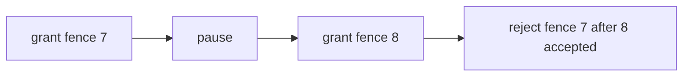

# A06.20 · distributed locks, leases and fencing

[Phase index](../README.md) · [Core] · 25–40 minutes

Prerequisite [A06.19](A06.19.md) · Next [A06.21](A06.21.md)

## 1. The problem & why it exists

A paused lock holder resumes after its lease expired and writes over the new leader. Enforce monotonically increasing authority where the side effect occurs. A local clock check alone does not fence stale operations.

## 2. Visual mental model



```text
01. grant fence 7
02. pause
03. grant fence 8
04. reject fence 7 after 8 accepted
```

Follow the responsibilities in order. The fixture isolates one mechanism. Check the workload and observation point before attributing the result to an actual deployment.

## 3. Step-by-step mechanism & minimal dry-run

A lease limits ownership under protocol and time assumptions. A fencing token is a monotonically increasing generation accepted or rejected by the actual resource.

**Trace.** grant fence 7 → pause → grant fence 8 → reject fence 7 after 8 accepted.

**Lease versus fence.** Lease expiry allows progress when a prior owner stops renewing. It cannot revoke a request that is already in flight. Treat a local check as advisory to the resource.

**Resource check.** Compare the incoming fence with durable authority at the same atomic boundary as the write. With token 8 accepted, reject token 7, regardless of its wall clock or request arrival order. If the operation is replayable, use its own scoped identity in addition to the fence.

## 4. Formal rigor & quantitative math

A resource with highest accepted token 8 rejects token 7. Equal-token policy depends on whether it represents a legitimate retry and on operation identity.

Predict the worked quantities by hand, then run the [example](../examples/A06.20.py). It uses a small calculation or state model. For arithmetic, retain the units attached to the worked formula.

## 5. Progressive design

| Run | Expected fixture result | Interpretation |
| --- | --- | --- |
| Failure control | `True` | Which assumption from the opening problem leads to this result? |
| Normal control | `False` | Enforce monotonically increasing authority where the side effect occurs. A local clock check alone does not fence stale operations. |

When the fixture reports a modeled value, use the lab to check the corresponding workload behavior. Compare work per request, retained bytes, and operational consequences only where the model measures them.

## 6. Safe local lab & controlled failure injection

```sh
uv run python "01-architecture-A01-to-A20/A06-distributed-systems-coordination/examples/A06.20.py"
uv run python "01-architecture-A01-to-A20/A06-distributed-systems-coordination/examples/A06.20.py" --break
```

Predict both results and identify which input or branch changes. Rerun the normal control as a repair. In a scratch copy, change one key, bound or assumption and predict the result again. Remove the scratch copy after recording your evidence. Apply this reasoning in [L4](../labs/L4.md).

## 7. Production & multi-cloud bridge

Enforce monotonically increasing authority where the side effect occurs. A local clock check alone does not fence stale operations. For deployments on AWS, Azure or Google Cloud, confirm quotas, limits and which observations are available at each service boundary. Run production comparisons with the same query mix and recovery objective.

<details>
<summary>Principal question and answer</summary>

What evidence would distinguish the opening failure from a storage-capacity problem? Start with the first divergent boundary in the trace and name the exact mechanism. A lease limits ownership under protocol and time assumptions. A fencing token is a monotonically increasing generation accepted or rejected by the actual resource.

</details>

## 8. Memory hook & mastery checkpoint

1. Name the operation at the first stage in the trace.
2. Explain the normal and broken outputs before running them.
3. Change one input and compute the revised result with units.
4. How would you test this boundary at deployment scale?
5. What is one assumption that limits the fixture?

<details>
<summary>Check your reasoning</summary>

1. grant fence 7.
2. Normal `False`. Failure `True`.
3. Reapply the relationship in section 4 to your changed inputs.
4. Enforce monotonically increasing authority where the side effect occurs. A local clock check alone does not fence stale operations.
5. The example uses a small calculation or state model. Check the primary reference for behavior outside that scope.

</details>

## Standards and implementation notes

- [Primary reference](https://etcd.io/docs/v3.6/learning/api_guarantees/)
