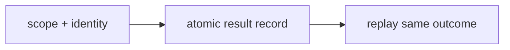

# A06.21 · idempotency and deduplication

[Phase index](../README.md) · [Core] · 25–40 minutes

Prerequisite [A06.20](A06.20.md) · Next [A06.22](A06.22.md)

## 1. The problem & why it exists

A retried command changes state twice because a dedup cache forgot its key. Use a durable receipt and match the retention policy to the unknown-outcome retry horizon.

## 2. Visual mental model



```text
01. scope + identity
02. atomic result record
03. replay same outcome
```

Follow the responsibilities in order. The fixture isolates one mechanism. Check the workload and observation point before attributing the result to an actual deployment.

## 3. Step-by-step mechanism & minimal dry-run

Deduplication has scope, retention and conflict rules. Record an operation identity with the effect and outcome so restart and concurrency cannot reopen the same action.

**Trace.** scope + identity → atomic result record → replay same outcome.

## 4. Formal rigor & quantitative math

Two identical commands adding 3 to 10 produce 16 without dedup and 13 with one effective application.

Predict the worked quantities by hand, then run the [example](../examples/A06.21.py). It uses a small calculation or state model. For arithmetic, retain the units attached to the worked formula.

## 5. Progressive design

| Run | Expected fixture result | Interpretation |
| --- | --- | --- |
| Failure control | `16` | Which assumption from the opening problem leads to this result? |
| Normal control | `13` | Use a durable receipt and match the retention policy to the unknown-outcome retry horizon. |

When the fixture reports a modeled value, use the lab to check the corresponding workload behavior. Compare work per request, retained bytes, and operational consequences only where the model measures them.

## 6. Safe local lab & controlled failure injection

```sh
uv run python "01-architecture-A01-to-A20/A06-distributed-systems-coordination/examples/A06.21.py"
uv run python "01-architecture-A01-to-A20/A06-distributed-systems-coordination/examples/A06.21.py" --break
```

Predict both results and identify which input or branch changes. Rerun the normal control as a repair. In a scratch copy, change one key, bound or assumption and predict the result again. Remove the scratch copy after recording your evidence. Apply this reasoning in [L2](../labs/L2.md).

## 7. Production & multi-cloud bridge

Use a durable receipt and match the retention policy to the unknown-outcome retry horizon. For deployments on AWS, Azure or Google Cloud, confirm quotas, limits and which observations are available at each service boundary. Run production comparisons with the same query mix and recovery objective.

<details>
<summary>Principal question and answer</summary>

What evidence would distinguish the opening failure from a storage-capacity problem? Start with the first divergent boundary in the trace and name the exact mechanism. Deduplication has scope, retention and conflict rules. Record an operation identity with the effect and outcome so restart and concurrency cannot reopen the same action.

</details>

## 8. Memory hook & mastery checkpoint

1. Name the operation at the first stage in the trace.
2. Explain the normal and broken outputs before running them.
3. Change one input and compute the revised result with units.
4. How would you test this boundary at deployment scale?
5. What is one assumption that limits the fixture?

<details>
<summary>Check your reasoning</summary>

1. scope + identity.
2. Normal `13`. Failure `16`.
3. Reapply the relationship in section 4 to your changed inputs.
4. Use a durable receipt and match the retention policy to the unknown-outcome retry horizon.
5. The example uses a small calculation or state model. Check the primary reference for behavior outside that scope.

</details>

## Standards and implementation notes

- [Primary reference](https://aws.amazon.com/builders-library/timeouts-retries-and-backoff-with-jitter/)
